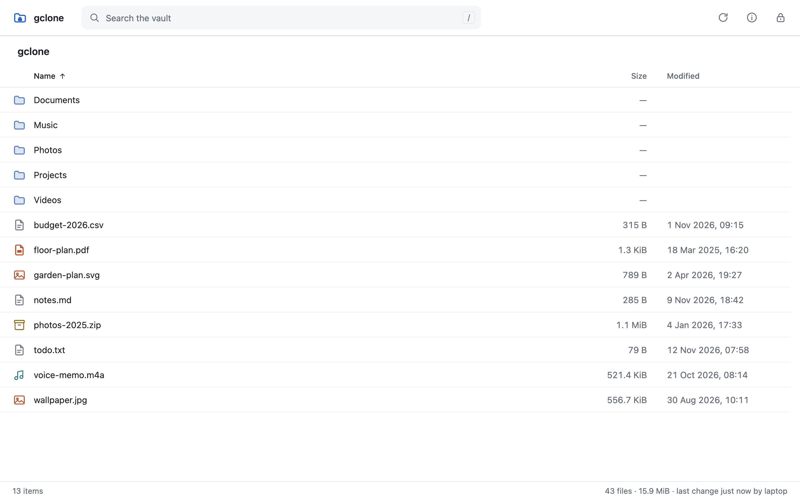
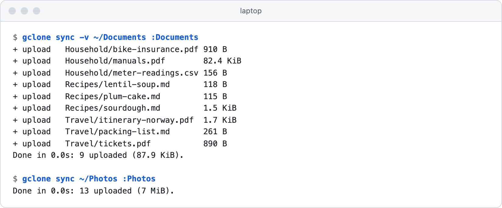
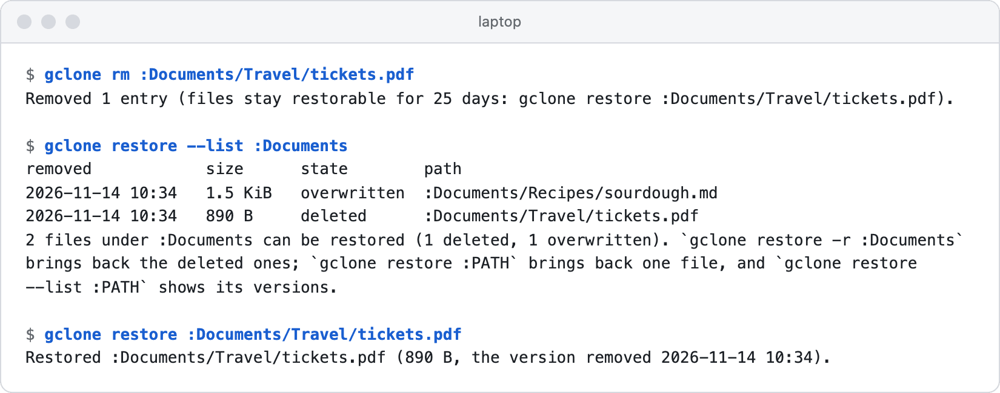
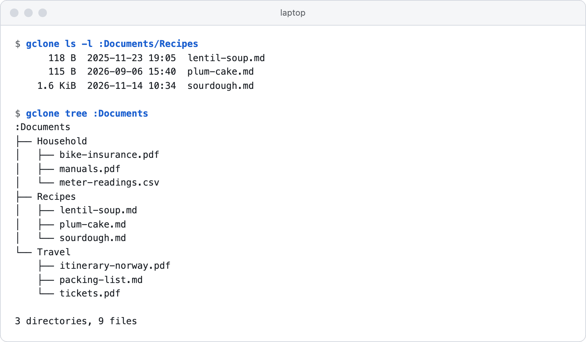
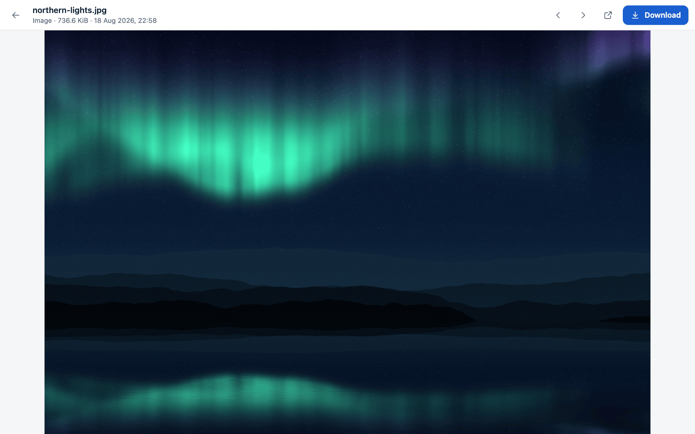
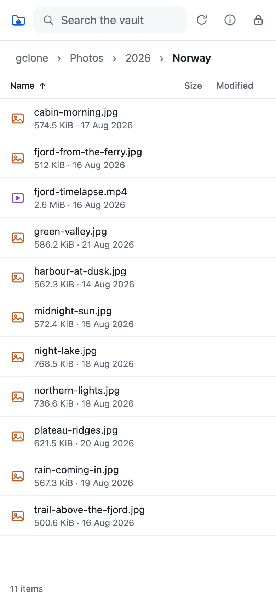
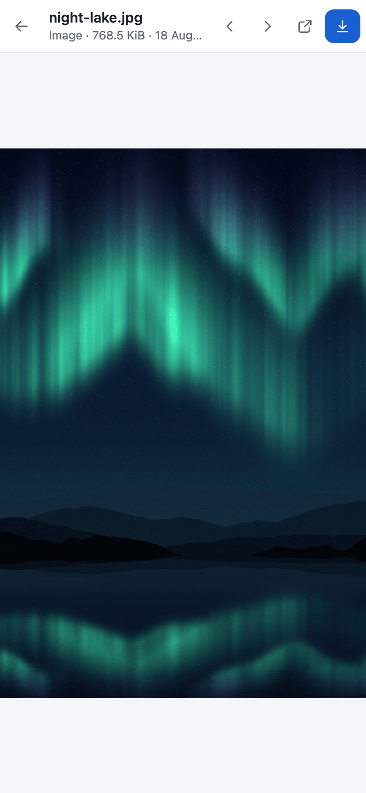
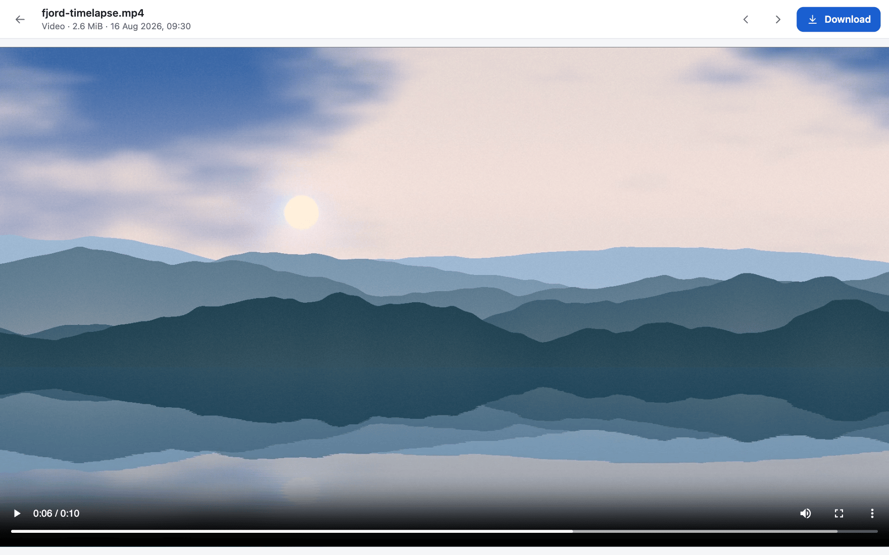
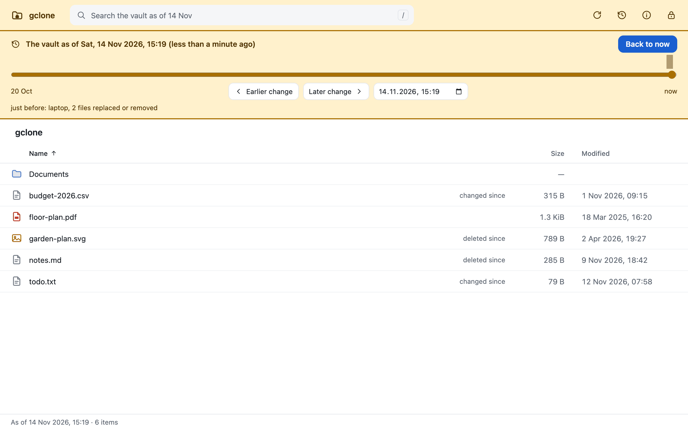
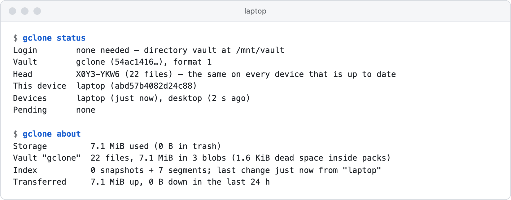

# gclone

gclone syncs folders to your own Google Drive and encrypts them on your machine first. File
contents, names and the folder tree are encrypted before upload, so Drive stores only
ciphertext. It is a command-line tool in the style of rsync (`sync`, `copy`, `ls`, `cat`, …)
for one person with several devices: deleted and overwritten files stay restorable for 25
days, a read-only viewer shows the decrypted vault in a browser, and
[restic](https://restic.net) can keep its backups on the same Drive through gclone.

<picture>
  <source media="(prefers-color-scheme: dark)" srcset="docs/images/viewer-list-dark.png">
  
</picture>

gclone is a single Rust binary for macOS and Linux; Windows is not supported. There is no
gclone service: you use your own Google account and a small sign-in helper, the auth Worker,
that you run yourself on Cloudflare ([Hosting your own](#hosting-your-own)).

## Install

Prebuilt binaries exist for macOS on Apple silicon and for Linux (x86_64 and aarch64, static).
To use Google Drive you also set up, once and before the first login, a Google OAuth client
and the auth Worker of your own ([Hosting your own](#hosting-your-own)); a vault in a local
directory needs neither.

This installs the latest release into `~/.local/bin`, without sudo:

```sh
curl -fsSL https://raw.githubusercontent.com/dwahdany/gclone/main/install.sh | sh
```

The script checks the download against the release's checksums and, when the
[GitHub CLI](https://cli.github.com) is installed and signed in, verifies the attestation
that these bytes were built by this repository's release workflow. On a Mac it installs the
Developer ID-signed build where a release has one.

To update, run the same command again. It replaces the binary and nothing else: the login,
the configuration and the local index stay. Update all your devices in reasonable time, since
an older gclone stops when it meets data written by a newer one. On a Mac that comes from
gclone 0.5.0 or older, read
[Upgrading a Mac to 0.5.1](docs/SECURITY.md#upgrading-a-mac-to-051) first. The installer's
options, and what each of its checks is worth, are in
[docs/USAGE.md](docs/USAGE.md#installing-and-updating).

### Building from source

Intel Macs and other machines without a prebuilt binary build gclone from source. You need
Rust 1.89 or later and a C compiler:

```sh
git clone https://github.com/dwahdany/gclone && cd gclone
cargo build --release --locked
mkdir -p ~/.local/bin && install -m 755 target/release/gclone ~/.local/bin/
```

[DEVELOPMENT.md](DEVELOPMENT.md) covers the build options, the tests, the screenshots,
publishing a release and the repository layout.

## Quick start

The first login on a device names [your auth Worker](#hosting-your-own). The release
binaries have the maintainer's Worker built in as the default, and it admits only the
maintainer's account, so give your own URL; gclone remembers it.

```sh
gclone login https://auth.example.org   # shows a code; enter it at google.com/device in any browser
gclone sync ~/Documents :Documents      # upload; a path that starts with ":" is in the vault
gclone ls -l :Documents
```

The first login creates the vault, a folder named `gclone` in your Drive, and asks for a new
passphrase. Leave the prompt empty and gclone generates a strong one, which is the safe
choice ([why](#security-in-brief)). **Store the passphrase in your password manager**: every
new device needs it once, and it cannot be recovered.

To try gclone before any setup, start with `gclone login --vault-dir ~/gclone-test` instead:
a directory as the vault needs no Google account and no Worker. The terminal pictures on
this page were recorded that way, so nothing in them waits for a network.

<picture>
  <source media="(prefers-color-scheme: dark)" srcset="docs/images/terminal-sync-dark.png">
  
</picture>

`copy` transfers the contents of a directory and never deletes. `sync` also deletes at the
destination what was deleted at the source since the last run. Both work in either
direction, and `-n` shows the plan without changing anything.

**A second device.** Install gclone there and sign in the same way. gclone finds the vault
and asks for the passphrase, once. Then compare `Head` in `gclone status` on both devices:
equal values mean that both see the same vault state, and a new device otherwise trusts
whatever Google serves it.

```sh
gclone login https://auth.example.org
gclone copy :Documents ~/Documents      # download
gclone status                           # "Head" must equal the first device's
```

Every command and option is described in [docs/USAGE.md](docs/USAGE.md#commands) and in
`gclone <command> --help`.

## Features

- **Sync that does not surprise.** `sync` deletes only what the same pair of directories has
  synced before, and asks before a large deletion. A change gclone has not seen is never
  overwritten: when both sides changed, the other version is kept as a conflict copy.
  Content that is already in the vault is not uploaded again, and renaming or moving a file
  transfers nothing.

- **Versions and trash.** What you delete or overwrite in the vault can be brought back
  for 25 days with `gclone restore`: one file, an older version of it, or with `-r` every
  deleted file under a directory. After that the data stays in the vault until `gclone gc`
  moves it to the Drive trash, which Google empties 30 days later; `gclone gc --purge`
  deletes it at once. What `sync` deletes on the local side is not kept.

  <picture>
    <source media="(prefers-color-scheme: dark)" srcset="docs/images/terminal-restore-dark.png">
    
  </picture>

- **Listing without waiting for Drive.** The folder tree lives in an encrypted index that
  every device keeps a copy of, so `ls`, `tree`, `mv` and `rm` do not walk the remote.

  <picture>
    <source media="(prefers-color-scheme: dark)" srcset="docs/images/terminal-ls-dark.png">
    
  </picture>

- **A viewer on your machine.** Drive's own pages show only ciphertext. `gclone web` opens
  the decrypted vault as a file browser in your default browser: folders, a search over
  every name, previews of images, PDFs, audio, video and text, and downloads. It is
  read-only, listens on this machine only, and writes no decrypted file to disk.

  <picture>
    <source media="(prefers-color-scheme: dark)" srcset="docs/images/viewer-image-dark.png">
    
  </picture>

- **A viewer for any browser.** Optionally, your auth Worker serves the same file browser
  as a web page, for a phone or a computer without gclone. You sign in with Google and
  enter the passphrase; the browser fetches ciphertext straight from Drive and decrypts it
  itself. The passphrase is asked for on every visit and stored nowhere. The screenshots on
  this page were taken in this viewer.

  <p>
    <picture>
      <source media="(prefers-color-scheme: dark)" srcset="docs/images/viewer-phone-dark.png">
      
    </picture>
    <picture>
      <source media="(prefers-color-scheme: dark)" srcset="docs/images/viewer-phone-image-dark.png">
      
    </picture>
  </p>

  Video and audio play with seeking, straight from the encrypted files:

  <picture>
    <source media="(prefers-color-scheme: dark)" srcset="docs/images/viewer-video-dark.png">
    
  </picture>

- **A time machine.** Both viewers show every kept version of a file, what was deleted from
  a folder, and the whole vault as it was at an earlier moment, for 25 days. Looking is all
  they do: the page shows the `gclone restore` command to copy.

  <picture>
    <source media="(prefers-color-scheme: dark)" srcset="docs/images/viewer-timemachine-dark.png">
    
  </picture>

- **A backend for restic.** `gclone serve restic` lets restic keep a repository on your
  Drive, beside the vault. restic does its own encrypting and deduplicating; gclone adds the
  Google sign-in and its Drive client. restic starts gclone by itself:

  ```sh
  restic -o rclone.program=gclone -r rclone:laptop init
  restic -o rclone.program=gclone -r rclone:laptop backup ~/Documents
  ```

- **A device key that a copy cannot use.** On a Mac with a Secure Enclave, the device's
  login and vault key are kept in a file that only that Mac can open, so a copy of it in a
  backup or on another machine is worthless. On Linux they are in a plain file with mode
  0600, to be treated like an SSH private key.

- **Vaults without Google.** `gclone login --vault-dir DIR` uses a directory as the store:
  a NAS mount, an external disk, or a vault folder downloaded from drive.google.com.
  `gclone status` shows what a device is attached to:

  <picture>
    <source media="(prefers-color-scheme: dark)" srcset="docs/images/terminal-status-dark.png">
    
  </picture>

The viewers, restic and directory vaults each have a section in [docs/USAGE.md](docs/USAGE.md).

## Security in brief

- **Encrypted on the device:** file contents, names, the folder tree, modification times
  and hashes. Every object is authenticated, so a changed, truncated or swapped object is
  detected.
- **What Google can still see:** the exact size of every file and the number of files, when
  you write and from which device, your account and your IP addresses.
- **What Google can still do:** delete data or roll the vault back, which gclone detects
  and cannot prevent. It can also withhold the newest changes from a device, or show a new
  device an older state, which only comparing `Head` between devices reveals.
- **The passphrase protects everything.** It wraps the vault key that is stored in the
  vault, so anyone who can read the vault folder, Google included, can try guesses offline:
  use the generated one. It is also the only recovery. Nobody can reset it for you; a
  device that is still connected can set a new one (`gclone passwd`).
- **No re-keying.** A vault keeps one key for its whole life. If the passphrase or a
  device's key leaks, the only full remedy is a new vault:
  [If a passphrase or a device's key file leaked](docs/SECURITY.md#if-a-passphrase-or-a-devices-key-file-leaked).
- **The auth Worker** sees Google tokens, so it can reach what Google can (ciphertext and
  deletion), never your file names, contents, passphrase or key. If you set up the viewer
  for any browser, whoever controls that page can take the passphrase.

[docs/SECURITY.md](docs/SECURITY.md) has the whole model, where a device keeps its key, and
what to do after a lost device.

## Hosting your own

gclone has no shared service to sign in to. Google lets a program into a Drive only through
an OAuth client, and the client's secret cannot be shipped in a public binary. So each
person who uses gclone with Google Drive runs, once:

- **a Google OAuth client** in a Google Cloud project of their own, and
- **the auth Worker** in [`worker/`](worker/), a small stateless Cloudflare Worker that
  holds that client's secret and lets in only the Google accounts named in its
  `ALLOWED_EMAILS` secret. File data never passes through it.

The free plans of both are enough. `worker/setup.sh` walks through the setup, and
[docs/SETUP.md](docs/SETUP.md) is the guide: the Worker, the Google client, the first
device, further devices. A device learns your Worker's URL from its first
`gclone login https://<your-host>` and remembers it; `GCLONE_AUTH_URL` in the environment
works too. To have your URL built in, build from source with `GCLONE_DEFAULT_AUTH_URL` set.

## Limitations

- **Young software with one user so far.** The maintainer runs it daily against Google Drive
  on a Mac and a Linux machine, and the automated tests run against a fake Drive and a fake
  Worker. The viewer for any browser has not been run on a phone yet. Work through the
  [day-0 checklist](docs/SETUP.md#day-0-checklist-before-the-first-real-use) before you
  trust it with data, and keep an independent backup.
- macOS and Linux only. No mount, no shared drives, no sharing between users. The viewers
  are read-only.
- `copy` and `sync` work on directories, in one direction per run; there is no two-way sync.
- Not synced: symlinks, extended attributes, permission bits other than the executable bit.
- The vault key cannot be changed, and a single device's access cannot be revoked: Google
  signs out all devices or none.
- Space comes back slowly: deleted data stays for 25 days, and `gc` reclaims it later.

The full list is in [docs/USAGE.md](docs/USAGE.md#limitations).

## Licence

MIT, see [LICENSE](LICENSE). gclone is provided "as is", without warranty of any kind: use
it at your own risk and keep an independent backup of anything you cannot afford to lose.
