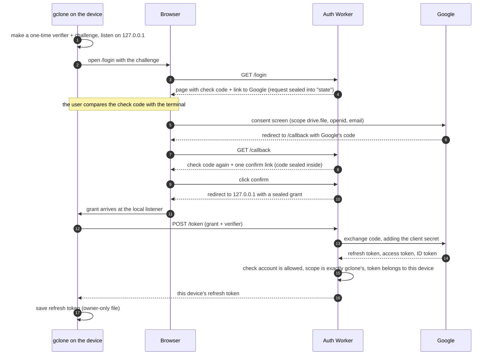
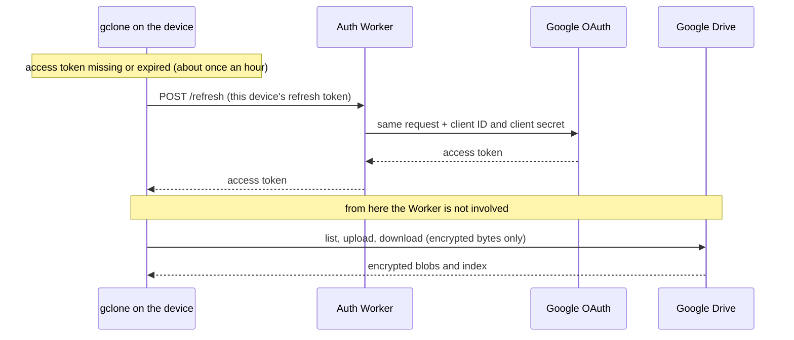

# How authentication works

gclone uses **one** Google OAuth client, held by **one** stateless Cloudflare Worker (`worker/`).
Every device gets its own refresh token through that Worker; file data travels directly between the
device and Google Drive.

The Worker has no KV, no database and no other storage. Its only binding is a rate limiter
(30 requests per minute per client address). Whatever it must remember between two steps of a login
travels in the browser's URL as an AES-256-GCM sealed, short-lived blob that only the Worker can open.

For the wire-level details (routes, parameters, blob formats) see [`SPEC.md`](SPEC.md) and
[`worker/README.md`](../worker/README.md).

## What lives where

| Place | Holds | Never holds |
|---|---|---|
| **Auth Worker** (Worker secrets) | Google client ID and client secret, the sealing key, the allowed Google account(s) | refresh tokens, file data, the vault key |
| **Each device** (owner-only files) | its own refresh token, a cached access token (about 1 hour), the unlocked vault key | the Google client secret |
| **Google Drive** (the vault folder) | encrypted blobs, the encrypted index, the vault key wrapped by the passphrase | the passphrase, any plaintext |
| **You** (password manager) | the vault passphrase, typed once per new device | — |

## Logging in a device (once per device)

- **Nothing is remembered between steps 4, 9 and 11.** Each response hands the browser a sealed blob
  and the next request brings it back.
- **The grant is bound to the device.** It opens only with the verifier that never left the device,
  and Google's code is redeemed at most 120 seconds after the second confirmation page was served.
  An OpenID Connect nonce derived from the device's challenge ties Google's code to that device.
- **Why two confirmation pages.** `/login` is unauthenticated, so anyone could fetch it and send its
  Google link to someone else. Showing the check code again after Google's consent means only the
  person at the terminal can complete the login.
- **Headless devices.** With `gclone login --no-browser`, step 11 shows a short string to paste into
  the terminal instead of redirecting to `127.0.0.1`; everything else is identical.
- **After login.** The device finds the vault on Drive, downloads the wrapped vault key and asks for
  the passphrase once. The first device creates the vault instead.

## Everyday use (every sync)

The Worker is contacted about once an hour per device, for a few hundred bytes. File data never passes
through it. If the Worker is unreachable, read-only commands keep working from the local replica while
the cached access token lasts; syncing resumes when the Worker is back.

## If something is lost or stolen

- **A device's refresh token.** With the `drive.file` scope it reaches only files gclone created, and
  those are ciphertext. A thief could delete them but not read them. Revoke gclone's access in the
  Google account and run `gclone login` again on the remaining devices.
- **The Worker's secrets.** The client secret alone grants nothing without the account owner's consent
  in a browser. Rotate it in the Google Cloud console and update the Worker secret.
- **The passphrase.** It is the only thing protecting the vault key stored on Drive, so it should be
  long and random. It cannot be recovered.
