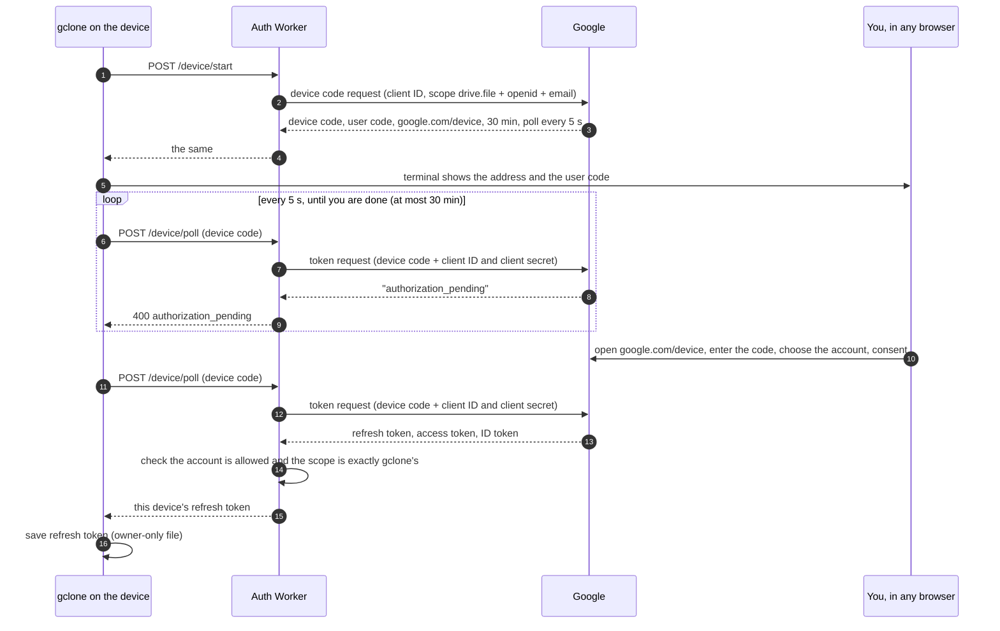
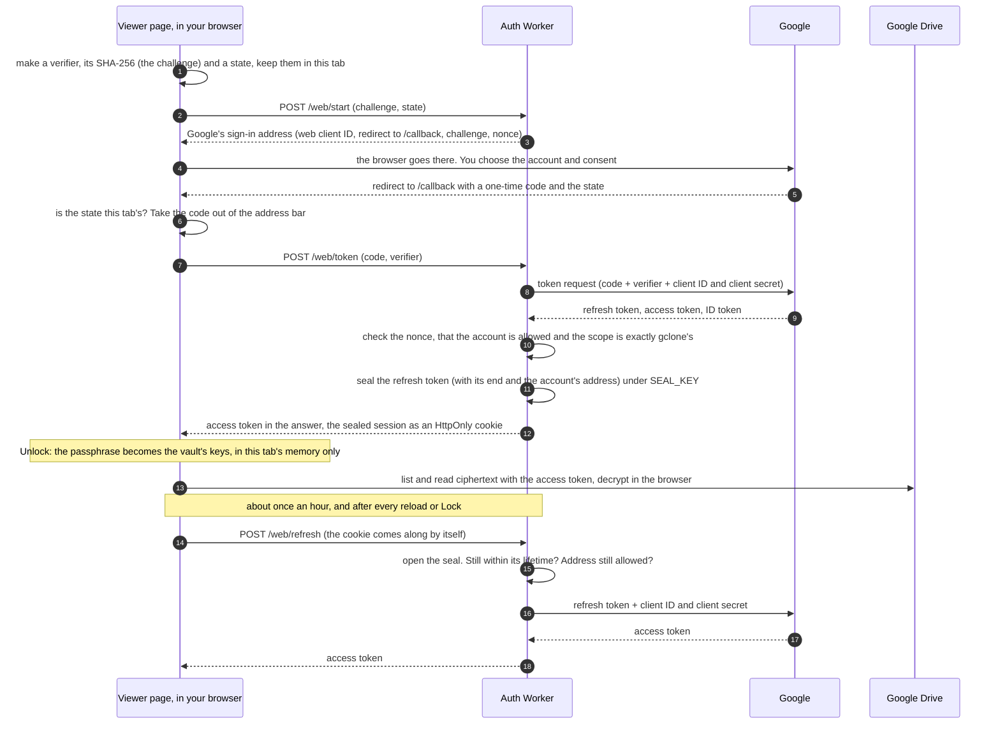
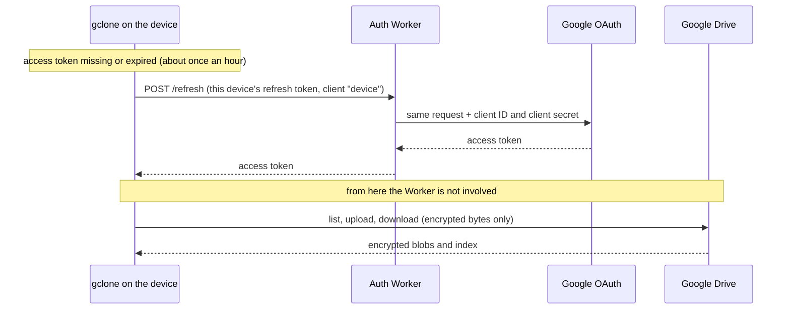

# How authentication works

gclone signs in with Google's **device authorization grant** (RFC 8628, "TVs and Limited Input
devices"): `gclone login` shows a short code, you enter it at `https://www.google.com/device` in any
browser on any device, and the terminal continues by itself. There is no redirect back to the
computer, so it works the same on a laptop, over SSH and on a headless server.

The OAuth client belongs to **one** stateless Cloudflare Worker (`worker/`), which is the only place
that holds its client secret. Every device gets its own refresh token through that Worker; file data
travels directly between the device and Google Drive.

The Worker has no KV, no database and no other storage. Its bindings are a rate limiter
(30 requests per minute per client address) and, since 0.4.0, the read-only static files of the
hosted viewer, which are part of the deployment. A login in progress is remembered by Google, under a
device code that the device itself carries from one request to the next.

Since 0.4.0 the same Worker can also sign a **browser** in, for the hosted viewer — a read-only page
at the Worker's address that decrypts the vault in the browser. That sign-in is a different flow
(a redirect, through a second OAuth client) with a different place for the long-lived token (a sealed
cookie): [Signing in a browser](#signing-in-a-browser-the-hosted-viewer) below. Everything about
devices is unchanged by it, with one exception: [devices that signed in before gclone 0.2.0](#devices-that-signed-in-before-gclone-020)
have to log in again.

For the wire-level details (routes, parameters, error codes) see [`SPEC.md`](SPEC.md) §2.3 and
[`worker/README.md`](../worker/README.md).

## What lives where

| Place | Holds | Never holds |
|---|---|---|
| **Auth Worker** (Worker secrets) | the device client's ID and secret; the allowed Google account(s); for the hosted viewer: the "Web application" client's ID and secret, and `SEAL_KEY`, the key that seals browser sessions | refresh tokens, device codes, file data, the passphrase, the vault key |
| **Auth Worker** (static files, part of the deployment) | the hosted viewer's page, scripts and WebAssembly — the same bytes for everyone | anything of a user |
| **Each device** (owner-only files) | its own refresh token, a cached access token (about 1 hour), the unlocked vault key | the Google client secret |
| **A browser signed in to the hosted viewer** | a cookie with that browser's refresh token **sealed under `SEAL_KEY`** (scripts cannot read it; the browser cannot open it); in the tab's memory, while it is open: an access token, and after the passphrase the vault's keys | the refresh token in the clear, the client secret; on disk: no key, nothing derived from the passphrase, no file name |
| **Google** (during a login) | the pending login: device code, user code, whether the code was entered | — |
| **Google Drive** (the vault folder) | encrypted blobs, the encrypted index, the vault key wrapped by the passphrase | the passphrase, any plaintext |
| **You** (password manager) | the vault passphrase: typed once per new device, and filled in by the manager on every visit of the hosted viewer | — |

**The Worker holds a sealing key again** (it had one before 0.2.0, and none from 0.2.0 to 0.3.x). It
still stores nothing: a browser session lives in the browser's cookie, and `SEAL_KEY` is what makes
that cookie readable to the Worker alone. The key of a 0.4.0 deployment is freshly generated — never
one left over from before 0.2.0 — and replacing it ends every browser session at once without
touching a device.

## Logging in a device (once per device)



What the terminal shows:

```
To sign in, open  https://www.google.com/device
and enter the code  ABCD-EFGH
(enter only a code shown in this terminal; waiting…)
```

- **The Worker remembers nothing between steps.** The device code is the whole state of a login, and
  it lives on the device and at Google.
- **The client secret never leaves the Worker.** The device sends its device code; the Worker adds the
  client ID and secret and asks Google.
- **What the Worker checks before it hands out a refresh token** (step 14): Google's ID token names a
  verified e-mail address that is on the allowlist (otherwise the Worker revokes the grant and
  refuses), the granted scope is no wider than gclone's and includes `drive.file`, and a refresh token
  is there. The address is compared exactly, apart from the case of the letters A–Z. To an account
  that is not allowed the Worker shows the address only masked (`s***@example.net`): anyone can poll.
- **Once Google has answered with tokens (step 13), the code is used up.** Whatever the Worker refuses
  after that ends the login at once, with the reason — including an answer from Google that lacks
  what the Worker needs, such as the ID token (`grant_unusable`). The device does not poll again.
- **Polling.** `slow_down` from Google makes the device wait 5 s longer between polls. A poll that
  does not get through (network, Worker, Google) is followed by the next one, after a pause that
  doubles with every failure in a row (at most a minute) and returns to normal with the first poll
  that is answered. Ctrl-C stops the login; nothing was stored. After 30 minutes the code is dead
  and `gclone login` has to be run again.
- **A browser on the same machine** is opened on Google's page for convenience (not with
  `--no-browser`, over SSH, or without a display). The code still has to be typed there. The device
  takes the address from the Worker but opens it only if it is a `google.com` address; anything else
  is printed with a warning and left to you.
- **After login.** The device finds the vault on Drive, downloads the wrapped vault key and asks for
  the passphrase once. The first device creates the vault instead.

### The weak spot: device-code phishing

`/device/start` needs no authentication — it cannot, the device has no credentials yet. So anyone who
knows the Worker's URL can start a login of their own, and then try to talk **you** into entering
**their** code at `google.com/device` ("your backup needs re-authorising, please enter WXYZ-…"). If
you do, the refresh token goes to them. The allowlist does not help: the account that consented is
yours, the allowed one.

What stands against it:

- The terminal says it, every time: **enter only a code shown in your own terminal.** Nobody ever has
  a reason to send you a gclone code. The Worker's home page says the same.
- **A web page never shows a code.** The hosted viewer signs in with a redirect and never shows or asks
  for a device code; its sign-in and unlock screens say so. A page that shows you a code "to sign in to
  gclone" is not gclone.
- Google's consent screen names the app and the access it asks for before anything is granted.
- `/device/start` and `/device/poll` are rate-limited (30 requests per minute per address), take no
  input that reaches Google except a pre-filtered device code, and log nothing but route and status.
  The limiter is the Worker's only binding, and `npm test` refuses a `wrangler.jsonc` that could
  deploy without it.

What remains if it happens anyway: the attacker holds a refresh token with the `drive.file` scope. It
reaches only the files gclone created, and those are **ciphertext** — without the passphrase nothing
can be read. They could move the vault to the trash or overwrite objects; Drive keeps trashed files
for 30 days and `gclone check` / `gclone repair` find damage. Ending it: remove gclone at
<https://myaccount.google.com/permissions> (or `gclone logout --revoke`), then `gclone login` again on
your devices.

## Signing in a browser (the hosted viewer)

The hosted viewer is a page at the Worker's own address. A browser can follow a redirect, so this
sign-in is Google's authorization-code flow with PKCE, through an OAuth client of type "Web
application" — not the device-code flow, and **no code is ever shown or typed**.



- **The tab that starts is the tab that finishes** (steps 1 and 6). The verifier and the state stay in
  the tab's session storage for the trip to Google and are removed on return. A code that arrives
  without this tab's state — an address someone sent you — is never sent on, and a code is useless
  without the verifier anyway (step 8).
- **The code is bound to this sign-in** (step 10). The Worker put a nonce derived from the challenge
  into Google's address; Google repeats it in the ID token; the Worker recomputes it from the
  verifier. A code from an address the Worker did not build for this verifier is refused.
- **The same checks as for a device** (step 10): a verified address on the allowlist (otherwise the
  grant is revoked), exactly gclone's scopes, a refresh token present.
- **The refresh token never reaches script** (steps 11 and 12). It is sealed (AES-256-GCM under a key
  derived from `SEAL_KEY`) together with the account's address and the session's end, and set as the
  cookie `__Host-gclone-web`: `HttpOnly`, `Secure`, `SameSite=Strict`, this host only. No answer body
  and no log line ever carries it.
- **A session has an end that use does not extend**: 12 hours after the sign-in, or 30 days if "Stay
  signed in" was ticked. It is inside the seal. After it: sign in again.
- **The allowlist is applied on every refresh** (step 15): the address is inside the seal, so removing
  it from `ALLOWED_EMAILS` cuts a browser off at its next request — and revokes the grant.
- **Only the viewer's own page can call these routes**: they require the page's own `Origin`, JSON
  bodies and the cookie, which the browser sends to this site only (`SameSite=Strict`); no answer
  carries a CORS header.
- **`/refresh` does not accept this client's tokens.** A refresh token of the Web application client is
  honoured inside the sealed cookie and nowhere else. That is what makes the three properties above
  real: the end, the allowlist, and `SEAL_KEY` as the switch that ends every browser session.
- **File data still never touches the Worker** (step 13): the browser talks to Google Drive directly,
  and what it gets is ciphertext.
- **Sign out** (`POST /web/logout`) drops the cookie and the page's stored data. It does not revoke
  anything at Google — that would sign every device out — and it does not sign the browser out of
  Google itself.

### Keys and tokens in the browser: where each one lives, and when it ends

| Secret | Created | Lives in | Ends |
|---|---|---|---|
| Passphrase | typed, or filled in by a password manager | the input field; one string handed to a short-lived worker — **and the browser's password store, if you let the browser save it** (the viewer cannot see or prevent that) | the field is cleared and the worker ended at once. A saved copy lives until you delete it in the password manager. |
| What the passphrase is stretched into (Argon2id), and the key that opens the keyfile | a worker that exists only for the unlock | that worker's memory (256 MiB for a moment) | the worker is ended on success, when the unlock screen is left, and after two idle minutes |
| The vault's master keys | that worker | handed directly to a second worker, which holds them and the decrypted index while the vault is unlocked. Never on the page itself, never stored. | Lock, reload, closing the tab |
| The key of one opened file (a "ticket") | the second worker | passed directly to the Service Worker, which decrypts that file's bytes as they stream. Never on the page itself. | Lock and Sign out, and when the tab is closed, reloaded or taken to another address; otherwise when the browser stops the Service Worker. It opens that one file and nothing else. |
| Access token (about an hour) | the Worker, from Google | a variable in the page and its workers | its expiry; never in an address, never stored |
| Refresh token | Google, at `/web/token` | sealed, in the `HttpOnly` cookie; in the Worker's memory during a request | the session's sealed end; Sign out; a new `SEAL_KEY`; revocation at Google |
| PKCE verifier and state | the page | the tab's session storage | removed on return from Google; ignored after ten minutes |
| `SEAL_KEY`, the client secrets | you (`SEAL_KEY`: 32 fresh random bytes) | Worker secrets | when you replace them |

What a visit leaves behind in the browser: the cookie (until Sign out or its end), the sort order you
chose, and history entries that hold two numbers and a flag — no address, title or history entry ever
contains a file or folder name (a file shown in a tab of its own is titled by a random id: its name
travels only with a download). Nothing derived from the passphrase, no key, no index.

**Locking** is by the clock, because a timer does not run in a tab the system has frozen: 15 minutes
without input, 5 minutes in the background, and any return from the browser's back/forward cache. A
lock is a page reload — the most complete wipe a page can do. The **Lock button** and **Sign out**
act on every tab of the viewer in that browser (the tabs tell each other two words, "lock" and
"out"); a lock by the clock is each tab's own. What neither reaches is a file you opened **in a tab of
its own** — a PDF, or anything through "Open in a new tab": that tab is no longer part of the viewer
and stays as it is until you close it.

**The rate limit and other sites.** The Worker's routes are limited per address (30 requests a
minute). A request that a web page of another site makes your browser send — which needs nobody's
permission — is refused **before** it is counted, on the viewer's routes (wrong `Origin`) and on the
device routes (a device is not a browser: any request that names a page as its sender is refused), so
that a page you happen to have open cannot use up your address's budget. Sign out is not limited at
all: it must always arrive.

### What this adds to the picture

Without the hosted viewer, nobody but you ever has a reason to ask for the vault passphrase, and the
Worker reaches ciphertext only. With it:

- **Whoever serves the page can take the passphrase.** That is the Worker — so Cloudflare, the
  Worker's secrets and the domain. Accepted by using the viewer; limited by a signed release bundle
  that the deployed files can be compared with ([`worker/README.md`](../worker/README.md), "Deploying
  the viewer"), which finds a changed file but not a Worker that answers selectively.
- **A page that only looks like the viewer** can combine the device-code trick below with a passphrase
  form. Three habits stop it: a web page never shows a code; the passphrase is filled in by the
  password manager, never typed into a web page; the viewer is opened from a bookmark.
- **Where the passphrase is saved matters.** A password manager Google can read (Google Password
  Manager with standard encryption, in a Chrome signed in to the vault's Google account) gives Google
  the ciphertext, the keyfile and the passphrase.

The threat model with all rows: [`SPEC.md`](SPEC.md) §1.3; the viewer itself: §7.5.

## Everyday use (every sync)



The Worker is contacted about once an hour per device, for a few hundred bytes. File data never passes
through it. If the Worker is unreachable, read-only commands keep working from the local replica while
the cached access token lasts; syncing resumes when the Worker is back.

## Devices that signed in before gclone 0.2.0

Until 0.2.0 the login went through a browser redirect and an OAuth client of type "Web
application". A refresh token belongs to the client that issued it. The Workers of gclone 0.2.0 to
0.3.x kept that old client for `/refresh` only, so that such a device went on working.

**The Worker of 0.4.0 no longer does: a device that signed in before 0.2.0 must run `gclone login`
once.** The Web application client is the hosted viewer's now, and its refresh tokens are honoured in
the viewer's sealed cookie only — if `/refresh` took them as well, a browser session would have no
end, no allowlist check and no off switch.

- A device says which client its token belongs to: `"client": "device"` in the `/refresh` request and
  in its `secrets.json`. A `secrets.json` without that field is a login from before 0.2.0, and
  `gclone status` warns about it.
- Such a request is answered `400 invalid_grant`, whatever is configured and without asking Google;
  the device says that its login is no longer served and to run `gclone login` (exit 4).
- `gclone login` on such a device signs in again (the code flow above) and replaces the old token —
  but only once the new login has seen the vault. Until then nothing on the device changes.
- **Do it before the 0.4.0 Worker is deployed**, first on a device that is attached to the vault, and
  do not run `gclone logout` there before it has worked: the old login cannot be issued again.

Whether Google shows the files created through one of the two clients to the other (both are in the
same Cloud project) is **not yet verified**. It matters twice: for a vault that was created before
0.2.0 and a device login made now, and for the hosted viewer, which signs in through the Web
application client and has to find a vault made through the device client. If Google does not,
`gclone login` says so and leaves the device as it was, and the viewer reports that it finds no vault;
[`worker/README.md`](../worker/README.md), "Moving from the browser sign-in", lists the ways out. A
**new** device cannot tell that situation from "there is no vault yet" and would create a second
vault — so let an attached device go first.

## If something is lost or stolen

- **A device's refresh token.** With the `drive.file` scope it reaches only files gclone created, and
  those are ciphertext. A thief could delete them but not read them. Revoke gclone's access in the
  Google account and run `gclone login` again on the remaining devices.
- **The Worker's secrets.** A client secret alone grants nothing without the account owner's consent
  at Google. Rotate it in the Google Cloud console and update the Worker secret. `SEAL_KEY` opens
  the session cookies of browsers — to someone who also has such a cookie. Replace it
  (`openssl rand -base64 32 | npx wrangler secret put SEAL_KEY`): every browser signs in again, no
  device notices.
- **A phone or laptop that was signed in to the hosted viewer.** It holds no key: the viewer stores
  none and locks by the clock. It holds a session — ciphertext and the keyfile, the ability to trash —
  until the session's end. Replace `SEAL_KEY` to end it now. If the browser had the passphrase saved
  and the device can be unlocked, that is a stolen unlocked device: revoke, sign in again, and know
  that the data it could reach stays exposed.
- **Control of the Worker or the domain**, if you use the hosted viewer: whoever has it can serve a
  page that takes the passphrase. `node scripts/verify-deployed.mjs https://<host> <tag>` (in
  `worker/`) compares what is served with the signed release; after a suspected change of hands,
  redeploy, rotate every secret, and stop using the viewer until you trust the host again.
- **The passphrase.** It is the only thing protecting the vault key stored on Drive, so it should be
  long and random. It cannot be recovered.
