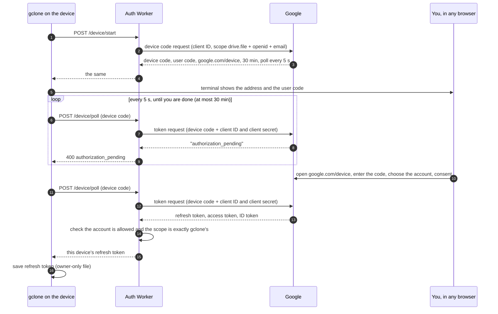
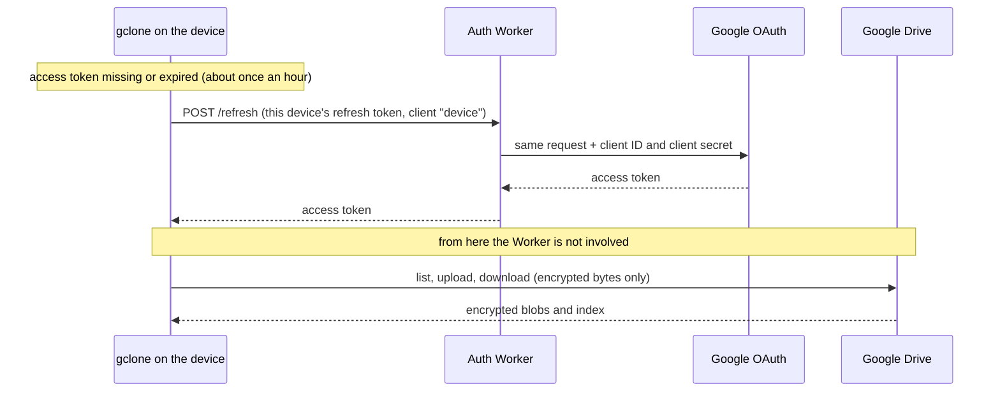

# How authentication works

gclone signs in with Google's **device authorization grant** (RFC 8628, "TVs and Limited Input
devices"): `gclone login` shows a short code, you enter it at `https://www.google.com/device` in any
browser on any device, and the terminal continues by itself. There is no redirect back to the
computer, so it works the same on a laptop, over SSH and on a headless server.

The OAuth client belongs to **one** stateless Cloudflare Worker (`worker/`), which is the only place
that holds its client secret. Every device gets its own refresh token through that Worker; file data
travels directly between the device and Google Drive.

The Worker has no KV, no database and no other storage. Its only binding is a rate limiter
(30 requests per minute per client address). A login in progress is remembered by Google, under a
device code that the device itself carries from one request to the next.

For the wire-level details (routes, parameters, error codes) see [`SPEC.md`](SPEC.md) §2.3 and
[`worker/README.md`](../worker/README.md).

## What lives where

| Place | Holds | Never holds |
|---|---|---|
| **Auth Worker** (Worker secrets) | Google client ID and client secret, the allowed Google account(s) | refresh tokens, device codes, file data, the vault key |
| **Each device** (owner-only files) | its own refresh token, a cached access token (about 1 hour), the unlocked vault key | the Google client secret |
| **Google** (during a login) | the pending login: device code, user code, whether the code was entered | — |
| **Google Drive** (the vault folder) | encrypted blobs, the encrypted index, the vault key wrapped by the passphrase | the passphrase, any plaintext |
| **You** (password manager) | the vault passphrase, typed once per new device | — |

There is no sealing key any more: the Worker has nothing of its own to carry between requests.

## Logging in a device (once per device)



What the terminal shows:

```
To sign in, open  https://www.google.com/device
and enter the code  ABCD-EFGH
(enter only a code shown in this terminal; waiting…)
```

- **The Worker remembers nothing between steps.** The device code is the whole state of a login, and
  it lives on the device and at Google.
- **The client secret never leaves the Worker.** The device sends its device code; the Worker adds the
  client ID and secret and asks Google.
- **What the Worker checks before it hands out a refresh token** (step 14): Google's ID token names a
  verified e-mail address that is on the allowlist (otherwise the Worker revokes the grant and
  refuses), the granted scope is no wider than gclone's and includes `drive.file`, and a refresh token
  is there. The address is compared exactly, apart from the case of the letters A–Z. To an account
  that is not allowed the Worker shows the address only masked (`s***@example.net`): anyone can poll.
- **Once Google has answered with tokens (step 13), the code is used up.** Whatever the Worker refuses
  after that ends the login at once, with the reason — including an answer from Google that lacks
  what the Worker needs, such as the ID token (`grant_unusable`). The device does not poll again.
- **Polling.** `slow_down` from Google makes the device wait 5 s longer between polls. A poll that
  does not get through (network, Worker, Google) is followed by the next one, after a pause that
  doubles with every failure in a row (at most a minute) and returns to normal with the first poll
  that is answered. Ctrl-C stops the login; nothing was stored. After 30 minutes the code is dead
  and `gclone login` has to be run again.
- **A browser on the same machine** is opened on Google's page for convenience (not with
  `--no-browser`, over SSH, or without a display). The code still has to be typed there. The device
  takes the address from the Worker but opens it only if it is a `google.com` address; anything else
  is printed with a warning and left to you.
- **After login.** The device finds the vault on Drive, downloads the wrapped vault key and asks for
  the passphrase once. The first device creates the vault instead.

### The weak spot: device-code phishing

`/device/start` needs no authentication — it cannot, the device has no credentials yet. So anyone who
knows the Worker's URL can start a login of their own, and then try to talk **you** into entering
**their** code at `google.com/device` ("your backup needs re-authorising, please enter WXYZ-…"). If
you do, the refresh token goes to them. The allowlist does not help: the account that consented is
yours, the allowed one.

What stands against it:

- The terminal says it, every time: **enter only a code shown in your own terminal.** Nobody ever has
  a reason to send you a gclone code. The Worker's home page says the same.
- Google's consent screen names the app and the access it asks for before anything is granted.
- `/device/start` and `/device/poll` are rate-limited (30 requests per minute per address), take no
  input that reaches Google except a pre-filtered device code, and log nothing but route and status.
  The limiter is the Worker's only binding, and `npm test` refuses a `wrangler.jsonc` that could
  deploy without it.

What remains if it happens anyway: the attacker holds a refresh token with the `drive.file` scope. It
reaches only the files gclone created, and those are **ciphertext** — without the passphrase nothing
can be read. They could move the vault to the trash or overwrite objects; Drive keeps trashed files
for 30 days and `gclone check` / `gclone repair` find damage. Ending it: remove gclone at
<https://myaccount.google.com/permissions> (or `gclone logout --revoke`), then `gclone login` again on
your devices.

## Everyday use (every sync)



The Worker is contacted about once an hour per device, for a few hundred bytes. File data never passes
through it. If the Worker is unreachable, read-only commands keep working from the local replica while
the cached access token lasts; syncing resumes when the Worker is back.

## Devices that signed in before gclone 0.2.0

Until 0.2.0 the login went through a browser redirect and an OAuth client of type "Web
application". A refresh token belongs to the client that issued it, so the Worker can keep that old
client for `/refresh` only, in two optional secrets (`GOOGLE_LEGACY_CLIENT_ID`,
`GOOGLE_LEGACY_CLIENT_SECRET`):

- A device says which client its token belongs to: `"client": "device"` in the `/refresh` request and
  in its `secrets.json`. A `secrets.json` without that field is a login from before 0.2.0.
- With the legacy secrets set, such a device keeps working unchanged. Without them it is told to run
  `gclone login` again (exit 4). With only one of the two set — the state between the two commands
  that add or remove the pair — it is told that the Worker is misconfigured; logins and devices of
  the new client are not affected.
- `gclone login` on such a device always signs in again (the code flow above) and replaces the old
  token — but only once the new login has seen the vault. Until then nothing on the device changes.
- Do this first on a device that is attached to the vault, and do not run `gclone logout` there
  before it has worked: the old login cannot be issued again.
- When every device has done that, delete the two legacy secrets and the old client.

Whether Google shows the files created through the old client to the new one (both are in the same
Cloud project) is **not yet verified**. If it does not, `gclone login` says so and leaves the device as it was;
[`worker/README.md`](../worker/README.md), "Moving from the browser sign-in", lists the ways out. A
**new** device cannot tell that situation from "there is no vault yet" and would create a second
vault — so let an attached device go first.

## If something is lost or stolen

- **A device's refresh token.** With the `drive.file` scope it reaches only files gclone created, and
  those are ciphertext. A thief could delete them but not read them. Revoke gclone's access in the
  Google account and run `gclone login` again on the remaining devices.
- **The Worker's secrets.** The client secret alone grants nothing without the account owner's consent
  at Google. Rotate it in the Google Cloud console and update the Worker secret.
- **The passphrase.** It is the only thing protecting the vault key stored on Drive, so it should be
  long and random. It cannot be recovered.
