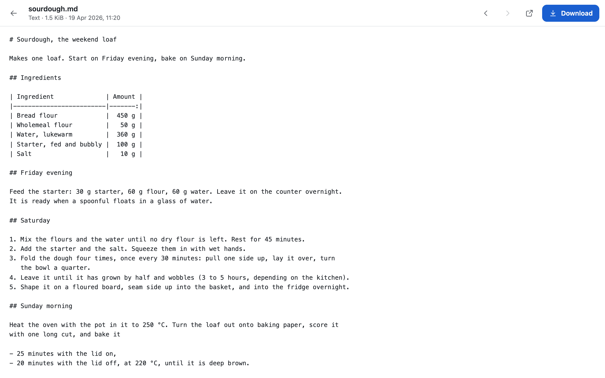
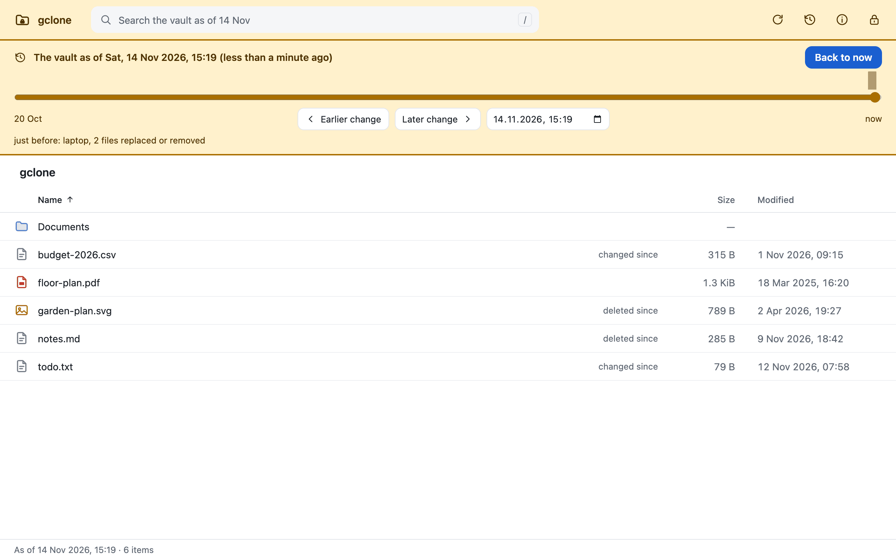

# Using gclone

Installing, every command, the two viewers, restic, the files gclone keeps on a device, exit
codes and limitations. The one-time setup of the auth Worker and the Google client, and
connecting devices, are in [SETUP.md](SETUP.md); what is protected and what is not, in
[SECURITY.md](SECURITY.md).

- [Installing and updating](#installing-and-updating)
- [Commands](#commands)
- [Browse the vault in your browser](#browse-the-vault-in-your-browser) (`gclone web`)
- [Browse from any browser (the hosted viewer)](#browse-from-any-browser-the-hosted-viewer)
- [Back up with restic](#back-up-with-restic)
- [Using a vault without Google](#using-a-vault-without-google)
- [How the vault is stored](#how-the-vault-is-stored)
- [Local files](#local-files)
- [Exit codes](#exit-codes)
- [Limitations](#limitations)

## Installing and updating

Prebuilt binaries for Linux (x86_64 and aarch64) and macOS on Apple silicon are attached to
this repository's GitHub Releases. The Linux ones are static: they need no particular
distribution or libc, and run inside WSL2 as well. `install.sh` picks the build for the
machine, checks it and puts it into `~/.local/bin` — no sudo, nothing else is touched.

```sh
curl -fsSL https://raw.githubusercontent.com/dwahdany/gclone/main/install.sh | sh
```

There is no prebuilt binary for Intel Macs or for Android/Termux: `install.sh` says so there
and stops. gclone itself runs on them — [build it from source](../DEVELOPMENT.md#building),
on Android inside Termux.

### What the installer verifies

What "checks it" is worth depends on whether the [GitHub CLI](https://cli.github.com) is
installed and signed in (`gh auth login`):

- **With `gh`**: the script verifies the archive's **build-provenance attestation**
  (`gh attestation verify`) — GitHub's signed statement, kept outside the release's files,
  that exactly these bytes were built by this repository's release workflow on the release's
  tag. A release whose files were replaced afterwards is refused.
- **Without `gh`**: the archive is checked against the release's `SHA256SUMS` only, and the
  script says so in one line. That shows a damaged download. It does not show a replaced
  release: the checksum list comes from the same place as the archive.
- **How new `gh` has to be**: **2.68.0** for the attestation (the script asks for the release's
  tag with `--source-ref`, which older versions do not know), **2.75.0** to check in addition
  that a signed macOS archive is a file of the published release (`gh release verify-asset`).
  An older `gh` counts as "too old": the script says which check it left out and goes on as
  without `gh` — or stops, under `--require-attestation`. `gh --version` shows yours.

Neither helps against someone who controls the repository itself: they can publish a
malicious release that is attested correctly, or change `install.sh`, which the install
command pipes into `sh`. To read the script first, download it instead of piping it.

### The signed build on a Mac

**On a Mac**, a release can also carry a **signed build**
(`gclone-aarch64-apple-darwin-signed.tar.gz`): the very binary the release workflow built
and attested, with a Developer ID signature added on the maintainer's Mac. Where a release
has one, `install.sh` installs it, after checking that

- the signature is valid and comes from an Apple-issued Developer ID certificate, with the
  hardened runtime and nothing else — no entitlements, no other flag;
- the signed binary is the unsigned one of the same release apart from the signature (it
  removes both signatures and compares the rest byte for byte);
- with `gh`: the unsigned archive is what the release workflow attested, and the signed
  archive is a file of the published release (`gh release verify-asset`);
- **the signer did not change**: if the gclone already installed is signed, the new one has
  to be signed by the same team under the same identifier. Replacing a signed gclone with an
  unsigned one — or with one signed by somebody else — stops, unless you pass
  `--allow-signer-change`.

The first signed install has nothing to compare with and trusts the signer it finds; the
script prints the team identifier. `--unsigned` installs the unsigned, attested build
instead. The signature buys a stable code identity on macOS and a check that an update comes
from the same signer; it is **not** what protects the key (see
[Where a device keeps its key](SECURITY.md#where-a-device-keeps-its-key)), and the same limit applies:
whoever controls the repository controls the script.

### Installer options

For a private fork, `install.sh` reads `GITHUB_TOKEN` / `GH_TOKEN` or uses a signed-in
[GitHub CLI](https://cli.github.com); point it at the fork with `--repo OWNER/NAME`.

Options go after `sh -s --`, or into the environment: `--version v0.6.2` (`GCLONE_VERSION`;
default: the latest release), `--dir DIR` (`GCLONE_INSTALL_DIR`; default `~/.local/bin`),
`--repo OWNER/NAME` (`GCLONE_REPO`), `--require-attestation` (install nothing that `gh` did
not verify), `--no-attestation` (checksum only: releases before 0.5.0 carry no attestation
of the binaries, so with a signed-in `gh` an older version installs only with this), and on
a Mac `--unsigned` (`GCLONE_UNSIGNED=1`) and `--allow-signer-change`
(`GCLONE_ALLOW_SIGNER_CHANGE=1`). If `~/.local/bin` is not on your `PATH`, the script says
so and names the line to add and the file it goes into (on Debian and Ubuntu, logging in again
is enough). It needs `curl` (`wget` is enough for a public repository), `tar`, `gzip` and
`sha256sum` (or `shasum` / `openssl`); `gh` is optional.

A `GITHUB_TOKEN` / `GH_TOKEN` in the environment, or a `gh` login, is used when there is one.
If GitHub refuses it (stale, expired, or for another repository), the script says so and
downloads without it, which is all a public repository needs.

Without GitHub — release archives copied to the machine, or built by hand —
`sh install.sh --base-url DIR` installs from a directory (a path, `file:///…` or `https://…`)
that holds `gclone-<target>.tar.gz` and `SHA256SUMS` (checksum only: a directory is not a
GitHub release).

### Which auth Worker a binary uses

`gclone login` has to know the URL of an auth Worker ([SETUP.md](SETUP.md)). It takes, in
this order: the argument (`gclone login https://<host>`), the environment variable
`GCLONE_AUTH_URL`, the URL this device used before (it is remembered and survives
`gclone logout`), and the URL compiled into the binary. `gclone --version` names the build
and the compiled-in URL:

```
gclone 0.6.2 (aarch64-unknown-linux-musl, auth URL https://auth.example.org)
gclone 0.6.2 (aarch64-apple-darwin, no auth URL built in)
```

The release workflow compiles in the repository variable `GCLONE_DEFAULT_AUTH_URL`, so this
repository's release binaries can carry its maintainer's Worker — which lets in only the
Google accounts on that Worker's allowlist, the maintainer's. With a Worker of your own,
pass its URL once per device: `gclone login https://<your-host>`. A binary you build
yourself can carry your URL ([DEVELOPMENT.md](../DEVELOPMENT.md#building)).

### CA certificates on Linux

On Linux gclone uses the system's CA certificates (the `ca-certificates` package — present on
any regular installation, missing in minimal containers, where every connection fails with "No
CA certificates were loaded from the system"); `SSL_CERT_FILE` names another bundle.

### Updating

Run the install command again: it replaces the binary with the latest release (or the one named
by `--version`, which is also the way back to an older one) and touches nothing else — the
login, the configuration and the local index stay. Update all devices in reasonable time: a
device that meets index objects written by a newer gclone stops with exit code 3 until it is
updated (see [Limitations](#limitations)).

On a Mac that comes from gclone 0.5.0 or older, read
[Upgrading a Mac to 0.5.1](SECURITY.md#upgrading-a-mac-to-051) first: 0.5.1 changes where
the device keeps its login and key.

## Commands

Remote paths start with `:` (`:` alone is the vault root). `copy` and `sync` take one local
directory and one remote directory; the direction follows from which one has the `:`. The
**contents** of the source go into the destination, as with `rsync SRC/ DST/`:
`gclone copy ~/Photos :Photos` puts `~/Photos/a.jpg` at `:Photos/a.jpg`; a trailing slash
changes nothing. A single file cannot be the source (`gclone cat :PATH > FILE` fetches one).

```sh
gclone copy ~/Documents :Documents          # upload; never deletes anything
gclone copy :Documents ~/Documents          # download; never deletes anything
gclone sync ~/Photos :Photos                # upload, and delete remotely what was deleted locally
gclone sync :Photos ~/Photos                # download, and delete locally what was deleted remotely
gclone sync -n ~/Photos :Photos             # dry run: show the plan, change nothing

gclone ls -l :Photos/2026                   # list; -R is recursive
gclone tree :Photos
gclone cat :Documents/notes.txt             # to stdout; --offset N --count N read a range
gclone web                                  # browse the vault in your browser (read-only; below)
gclone mkdir :Archive/2027
gclone mv :Photos/old :Archive              # into an existing directory: :Archive/old (no data is transferred)
gclone mv :Photos/old :Photos/2019          # otherwise a rename; replaces nothing without --force
gclone rm -r :Archive/tmp                   # files stay restorable for 25 days
gclone restore --list :Archive              # what can be restored under a directory (`:` = everywhere)
gclone restore -r :Archive/tmp              # bring back every deleted file under it, in one step
gclone restore --list :Documents/notes.txt  # one file: versions overwritten or deleted in the last 25 days
gclone restore :Documents/notes.txt --version 2

gclone status                               # login, vault, head fingerprint, devices, pending changes, key store
gclone about                                # storage use, dead space, index shape
gclone check                                # every blob present, right size and md5 (cheap)
gclone check --download [:PATH]             # download and authenticate every file
gclone check ~/Photos :Photos               # compare a local tree with the vault by content
gclone gc                                   # trash data unreferenced for more than 30 days
gclone gc --purge                           # ...and delete for good what gc trashed earlier
gclone repair                               # republish missing index objects from this device's cache
gclone passwd                               # new passphrase (for future devices); the old keyfile goes to the trash
gclone passwd --purge-old                   # ...and the old keyfiles are deleted for good, trash included
gclone keystore                             # where this device keeps its login and key; the Secure Enclave test (macOS)
gclone keystore check                       # can this session (cron, ssh, a LaunchAgent) use the Secure Enclave? exit 0 = yes
gclone keystore use file                    # macOS: keep the login and key in the plain file — now and from now on
gclone keystore use enclave                 # macOS: seal them now instead of waiting for the test (checks the passphrase first)
gclone logout                               # remove this device's login and cached key
```

`gclone login` and its options are described in [SETUP.md](SETUP.md#adding-a-device),
`gclone logout --revoke` and `--forget` in
[SECURITY.md](SECURITY.md#lost-or-stolen-device) and under [Local files](#local-files),
`gclone serve restic` under [Back up with restic](#back-up-with-restic).
`gclone <command> --help` prints every option of a command.

**Connecting a device to a large vault.** After the passphrase, a new device reads the
vault's index once: the newest snapshot of it, then the changes made since. On a vault of
several hundred thousand files that is a download of 100–200 MB and takes from some seconds
to a minute or more, depending on the connection — and longer on a vault so new that it has
no snapshot yet, whose changes are fetched one by one. The terminal shows where it is:

```
Downloading index   [=========>      ] 92.10 MiB/139.43 MiB  19.40 MiB/s  eta 2s
Loading index       [=====>          ] 311,296/860,000 entries  eta 2s
```

then `Downloading changes` and `Applying changes` for what the snapshot does not cover, and
`Connected to vault …` at the end. Where stderr is not a terminal (a script, a log file) there
is no bar: each phase prints a line when it begins (`Loading index: 860,000 entries`) and one
every ten seconds while it lasts (`Loading index: 311,296 of 860,000 entries`). A small vault
shows none of this — it is connected before there is anything to report — and `-q` prints
neither bar nor lines. If the login is interrupted, run it again: an index object that
arrived whole is kept and not downloaded twice, and a load that did not finish is undone as
a whole. Later commands read only what changed since.

### How `copy` and `sync` behave

- **Change detection** is size + mtime + ctime, with content hashes (BLAKE3) where those do not
  settle it; `--checksum` hashes everything.
- **Nothing unseen is overwritten.** gclone remembers what each local directory looked like
  when it was last in sync with its remote path (a three-way comparison). If the other side
  changed meanwhile, the file is skipped and reported (`! skip … remote is newer`), and when
  both sides changed the remote version is kept as `name.conflict-<device>-<n>.ext` (uploads)
  or the local one as `name.conflict-local-<time>.ext` (downloads). `--force` overwrites
  such a skipped file (and uploads again what was deleted in the vault); it does nothing else.
  A run with skipped files exits with code 6. With `-q` the skip lines are not printed, so the
  first ten reasons go to stderr instead.
- **`sync` deletes only what this directory pair has synced before**: a file that was
  transferred earlier and has since been removed from the source is removed from the
  destination. Entries that exist *only* at the destination and were never synced — what
  another device uploaded, what was always only there — are **never** deleted, not with
  `--force` either. `sync` keeps them, reports them (`! skip … only in the vault and never
  synced here`) and exits 6 on every run until you decide: fetch them with a `copy` in the
  other direction (`gclone copy :Photos ~/Photos`), or remove them (`gclone rm`, or by hand
  locally). Two devices that share one remote directory therefore run `copy` or `sync` *down*
  as well as up. A first sync never deletes anything.
- **Deletions are guarded.** More than 100 deletions, or 10 or more that are over a quarter
  of the destination, need a confirmation at the terminal or `--yes`. `--max-delete N` is a
  hard limit instead: up to N deletions run without a question, and a run that would delete
  more is refused whatever else is given — `--yes` does not lift it — so
  `gclone sync … --yes --max-delete 20` in a cron job never deletes more than 20 entries.
  What `sync` deletes in the vault stays restorable for 25 days (`gclone restore -r :PATH`);
  what it deletes locally is gone.
- **The safety guards say what to do** (exit code 5, nothing changed): a source directory
  that does not exist, or is empty although it was synced before (an unmounted disk), is
  refused — `--force` if it is meant; a local tree that looks restored from an older copy
  likewise. When the local directory is not the one last synced with that remote path (it was
  replaced, restored from a backup, or sits on a file system without stable inode numbers),
  gclone asks — and off a terminal needs — one of **`--keep-pair`** (it is the same
  directory: keep the sync state) and **`--reset-pair`** (start over: a first sync that
  deletes and overwrites nothing).
  On a file system without stable inode numbers (some network mounts) pass `--keep-pair` on
  every run; after the directory was restored from a backup or damaged, `--reset-pair`.
- **A remote path that does not exist is an error** for everything that reads from it:
  `gclone copy :Documnets ~/restore` fails with exit code 1 and creates nothing instead of
  reporting an empty success, and so do `check --download :PATH` and `check LOCAL :PATH`.
  (Uploading *to* a new path creates it.)
- **Excludes**: `--exclude GLOB` (repeatable, gitignore syntax) and a `.gcloneignore` file in
  the root of the local tree. Excluded files are neither transferred nor deleted, on either
  side — also when the other side spells the name differently (case, Unicode form). As in
  git, nothing under an excluded directory can be re-included: `build/` + `!build/keep.txt`
  keeps the file excluded; write `build/*` + `!build/keep.txt` instead.
- **gclone's own files are never synced**: when the local directory contains gclone's
  configuration or state directory (`~/.config/gclone`, `~/.local/state/gclone` — as when you
  back up your whole home directory) or the directory of a `--vault-dir` vault, those are
  skipped in both directions with a note, and a local directory *inside* one of them is
  refused.
- **Identical content is uploaded once**: a renamed, moved or copied file whose content is
  already in the vault costs an index entry, not an upload (`= reuse`).
- **Ctrl-C** during `copy` / `sync` ends the transfers within about five seconds — also the
  ones that wait for a network that has gone away — then commits what is finished and exits
  130; running the same command again continues. (The commit itself needs the network; a
  second Ctrl-C exits at once.) A killed process loses nothing that was reported as done.
- **Files that change or disappear while a run is in progress** (an editor's swap file, a
  build's temporary files) are skipped and reported (`changed while it was uploaded`, exit
  code 6); the next run picks them up or forgets them. A skip does not hold back the deletes
  of a `sync`. A file that fails — it exists but cannot be read, an upload or download
  that kept failing — does: then nothing is deleted in that run.
- **When Google throttles** (a quota, or a rate limit that outlasts gclone's own retries),
  the run stops starting transfers in either direction, keeps what is finished and exits with
  code 75; run the same command again later.
- `--transfers N` (1–64, default 4) sets the number of parallel uploads; `--json` prints
  NDJSON events for `copy` / `sync` (and one JSON object for `gclone keystore` without a
  subcommand) and is refused (exit code 2) by every other command, which has no JSON
  output; `-v` / `-vv` / `-vvv` or `GCLONE_LOG=debug` raise the log level (log lines go to
  stderr).

### How `mv`, `rm` and `restore` behave

All three change only the index; no data moves.

- **`mv :SRC :DST`** follows the shell: if `:DST` is an existing directory, the source moves
  *into* it and keeps its name; otherwise it is renamed to `:DST`. Nothing that exists at the
  destination is touched unless you pass `--force`: then a file replaces a file, and a
  directory is merged into a directory of the same name, replacing files of the same name.
  The command reports how many files were replaced; they stay restorable for 25 days. A file
  never replaces a directory, nor a directory a file.
- **`rm` and `restore`.** Deleted and overwritten file versions stay restorable for 25 days.
  `restore --list :DIR` lists the restorable files under a directory (`deleted`, or
  `overwritten` when the path exists again in a newer version); `restore -r :DIR` brings back
  the newest removed version of every *deleted* file under it in one step and leaves files
  that exist now alone; `restore :FILE [--version K]` brings back one version of one file,
  replacing the current one (which stays restorable). Several paths can be given. Empty
  directories are not restored.

  `restore --list :FILE` shows the versions of one file, newest first, with a number `K` and
  an id in the last column. `--version` takes either: `--version 2`, or `--version
  @3fa9c2d1e07b`. A number is a position, and it moves when another version is removed; an
  id names the same version for as long as it is kept, which is why the viewers'
  [time machine](#the-time-machine) shows commands with ids.

### How `gc`, `repair` and `passwd` behave

- **`gc` runs only on a complete index.** It is the one command that judges what is dead, so
  it does nothing (exit code 3, in all three steps: plain, `--orphans`, `--purge`) whenever
  this device knows that its view of the vault may be incomplete: the index has a gap or was
  rolled back, a segment still waits for its predecessors, **an index object failed
  verification and was ignored**, or a newer snapshot could not be used. The message names
  the object. Run `gclone repair` on a device that has seen it; an object that no device has
  (a planted or destroyed one) has to be removed from the vault's `index` folder in
  drive.google.com before `gc` runs again. `gc` also does nothing (exit code 5) while
  Google's clock and this device's are more than a day apart, because every age it judges by
  is measured on Google's clock.
- **`repair`** puts back what this device's local index cache holds and the vault no longer
  does — also an index object that still stands under its name but with other bytes (it was
  overwritten or replaced; the impostor goes to the trash) — and then publishes a snapshot of
  everything this device knows. Any device that has applied the missing objects can repair
  the vault for all.
- **`passwd`** needs no old passphrase (the device already has the key). It writes a new
  keyfile, reads it back from the vault and compares it, and only then retires the old one:
  into the Drive trash by default, where it — and the old passphrase with it — keeps working
  for 30 more days, which is also your way back if the new passphrase gets lost together with
  the last connected device. `--purge-old` (or a yes to the question at a terminal, which is
  asked **before** anything is written — Ctrl-C there changes nothing) deletes the old
  keyfiles for good instead, together with **every** keyfile in the Drive trash, whatever
  put it there: that is the choice when an old passphrase may have leaked. It says "gone …
  trash included" only after listing the folder and its trash again, and names what is
  left otherwise. If `passwd` is ever cut off between writing the new keyfile and retiring
  the old one, `gclone check` warns that two keyfiles are in the vault folder; running
  `gclone passwd` again settles it. **Neither form changes the vault's key**; what a
  passphrase change can and cannot do:
  [If a passphrase or a device's key file leaked](SECURITY.md#if-a-passphrase-or-a-devices-key-file-leaked).

### What is not synced

Symlinks, special files, names that are not UTF-8 (counted and reported), permission bits
other than "executable or not", directory mtimes, extended attributes. A download that
replaces an existing file keeps that file's permission bits (a `chmod 600` file stays
private); a file that is new on a device gets 0644 / 0755 under your umask.

## Browse the vault in your browser

Everything on Drive is ciphertext, so Google's own pages show nothing useful. `gclone web`
starts a small web server on this machine and opens the **decrypted** vault as a file browser
in your default browser: folders with breadcrumbs, a list sortable by name, size and time, a
search over every file and folder name in the vault, previews (images, PDF, audio and video
with seeking, text and code) and downloads.

<picture>
  <source media="(prefers-color-scheme: dark)" srcset="images/viewer-text-dark.png">
  
</picture>

```sh
gclone web                             # opens the browser; Ctrl-C in the terminal ends it
gclone web --no-browser --port 8377    # only print the link; a fixed port instead of a free one
```

It is **read-only**: no upload, rename, delete or restore — those stay with the commands
above. It shows what this device's index knows; **Refresh** in the page reads the vault's
index again, so that uploads from other devices appear. The viewer holds no lock while it
runs: `gclone sync` in another terminal works as usual. Keys: arrows, Enter, Backspace (up
one folder), Esc, and `/` for the search.

Security, in three sentences. The server listens on this machine only (`127.0.0.1` and `::1`;
there is no option for anything else) and answers only to a browser that came in through a
one-time link — printed in the terminal, or, when gclone opens the browser itself, handed
over in a private file rather than on a command line that other users of the machine could
read — which is traded for a session cookie that the browser sends to this server and to no
other program on the machine; another user, or a web page that guesses the port, gets a `403`
and nothing else, and requests under a foreign host name or from another site are refused as
well. Files are decrypted on their way to the browser, never written to disk, and treated as
untrusted content: an HTML or SVG file from the vault never runs as a page of the viewer
(HTML is shown as text, anything unknown is a download). The names of your files and folders
stay out of the browser's address bar, tab title and history — the address never changes
while you browse, and files are fetched under opaque ids — so nothing of the vault ends up
in a history that the browser may sync to its vendor.

What remains: anyone who can already read your files or your browser profile can read the
vault through the viewer too; the places you visited in a tab stay in the browser's
session-restore data (so that reload and "restore tabs" work) until the tab and its "recently
closed" entry are gone; and a file you download is in the
browser's download list under its name, like any download.

**A new link ends the old sessions.** Press Enter in the terminal for a new link — to move
to another browser, or after closing the first. Every link and every browser session from
before stops working at that moment, downloads included. So if a link ever answers "has been used
already" although you did not open it, press Enter: whoever was faster is shut out.

**Signing out ends the viewer.** `gclone logout` on this device stops a viewer that is still
running in another terminal within a second or so (it exits with a message); it does not go
on serving a device you have just signed out.

**From another machine.** The viewer never listens on the network. To browse the vault of a
machine without a display from your laptop, forward the port over SSH — the same number on
both ends — and open the printed link on the laptop:

```sh
ssh -t -L 8377:127.0.0.1:8377 nas gclone web --port 8377
```

(`-t` gives the remote gclone a terminal, so that Ctrl-C and a closed connection end it; under
SSH it prints the link and does not look for a browser.)

### The time machine

Both viewers, `gclone web` and the hosted one, also show what the vault held before: the
versions that `gclone restore` can bring back. They are kept for 25 days after they were
replaced or deleted.

<picture>
  <source media="(prefers-color-scheme: dark)" srcset="images/viewer-timemachine-dark.png">
  
</picture>

- **Versions of a file.** In a preview, **Versions** lists the file as it is now and every
  earlier version that is kept: until when it was the current one, its size, which device
  replaced or deleted it, and which device wrote it. Choosing a version shows it in the
  preview; Download saves that version.
- **Deleted files.** **Show deleted**, at the right of the folder path, adds a section below
  the folder's rows with what was deleted from it: files, and folders with the number of
  kept files in them (where nothing was deleted, the line under the list says so). A
  deleted file opens on its last version. A deleted folder opens with its deleted content,
  and can be shown as it was just before it went.
- **The vault at an earlier moment.** The clock button opens a bar with a slider over the
  last 25 days (one step is an hour), buttons that step from one change of the vault to the
  next, and a date field. At an earlier moment the list, the folders, the search and the
  previews show the vault as it was then. The bars change colour, the bar and the line under
  the list name the moment, and rows say what became of an entry: "changed since" or
  "deleted since". **Back to now** returns, and so does the right end of the slider.

**Bringing something back** stays a command. For an earlier version the Versions panel shows
`gclone restore :PATH --version @ID`, for a deleted folder the page shows `gclone restore -r
:DIR`, each with a Copy button. Run it on a device that is attached to the vault. The
command is written for sh, bash, zsh and fish. A name that cannot be carried safely in all
of them gets no command — one with a line break or another control character, with a
backslash, or with a character that turns the text around it (U+202E and its kin) — and
`gclone restore --list` on its folder shows what can be brought back.

**How exact the times are.** The index records when a version was *removed*, not when it was
written. What follows holds when the clocks of your devices are right.

- Everything that replaced or removed something is placed exactly: an overwrite, a deletion,
  a move.
- A file that was added without replacing anything appears at the time its upload was made,
  usually a few seconds before the change was complete, and such times carry "≈" in the
  list of versions. A file put over another one with `copy --force` shows that early, too:
  for those seconds the new content stands in the old one's place.
- An entry that came without an upload of its own — a folder made with `mkdir`, an empty
  file, a restored file, a copy of content the vault already had — has no time on record at
  all. It is shown from the last moment its device is known to have done something before
  it (never from before the device joined the vault), until the device's next recorded
  change settles it. In between its row says "≈ may have come later": a file restored on
  the 20th by a device last seen on the 3rd is listed, with that mark, from the 3rd on —
  or from its deletion, if that was later — although it was deleted then. Such changes have
  no stop on the timeline.

Nothing that existed is hidden, and nothing is shown after it was removed. On a directory
vault (`--vault-dir`) the times are those of the devices' own clocks: a device whose clock
is ahead places its changes late, so what it added is missing from earlier moments until
that time is reached, and one whose clock is behind places them early. On Google Drive the
times are Drive's.

In the hosted viewer the 25 days are counted on the clock of the device you browse with. A
clock that is far off moves the window: set far ahead it hides recent history, set far back
it offers versions whose data may be gone, and those end in a message, not in wrong content.

## Browse from any browser (the hosted viewer)

`gclone web` needs a device that is attached to the vault. The **hosted viewer** needs only a
browser: a read-only page at your Worker's address, `https://<host>/`, for a phone or a
computer without gclone. You sign in with Google, the password manager fills in the vault
passphrase, and you get the same file browser as `gclone web` — folders, sorting, search over
every name, previews (images, PDF, audio and video with seeking, text) and downloads of any size.

It is optional and off until you set it up:
[`worker/README.md`, "The hosted viewer: setup"](../worker/README.md#the-hosted-viewer-setup).

**How it works.** The page signs your browser in to Google with a redirect; the Worker keeps
that sign-in sealed in a cookie that scripts cannot read, and hands the page a short-lived
access token. With it the browser fetches **ciphertext** straight from Google Drive and
decrypts it itself, with gclone's own read path compiled to WebAssembly. The Worker never
sees a file, a name, the passphrase or a key. Nothing derived from the passphrase is stored
anywhere: it is asked for on every page load, and the keys live in the tab's memory until you
lock, reload or close it.

**What you trust when you use it.** Without the hosted viewer, the Worker and Cloudflare
reach ciphertext only. With it, whoever serves the page — your Cloudflare account, the
Worker's secrets, the domain — can serve a page that takes the passphrase, and with it every
file; and anything that runs script in the page, a browser extension for instance, sees what
the page sees. Read
[The hosted viewer: what you trust](SECURITY.md#the-hosted-viewer-what-you-trust) before you
set it up: what limits that trust, three habits against phishing, and where to save the
passphrase.

**Locking and signing out.** The Lock button forgets the keys, in every tab of the viewer
that is open in that browser; so do, for each tab by itself, 15 minutes without input and 5
minutes in the background (by the clock, so a phone that was put away comes back at the
passphrase screen), and any reload. A session lasts 12 hours, or 30 days with "Stay signed
in" — tick that on your own devices only. "Sign out" ends the viewer's session, clears what
the page kept and takes every other tab of the viewer to the sign-in screen; it does **not**
sign the browser out of Google, so on a computer that is not yours sign out of Google as
well (the signed-out screen links to it). **A file that you opened in a tab of its own** —
an image, a text or a PDF through "Open in a new tab" —
**has left the viewer: it stays on the screen after Lock and after Sign out. Close that tab
yourself.** To end
every browser session at once — a lost phone — put a new `SEAL_KEY` on the Worker
(`worker/README.md`, "Operating it"); devices are not affected.

**Limits.**

- Read-only, like `gclone web`: no upload, rename, delete or restore. (The Google token the
  page holds *could* overwrite or trash ciphertext — Google has no read-only form of
  `drive.file`; that the viewer never does is a property of its code.)
- Every visit is a fresh device: the viewer trusts the vault state it is served and cannot
  notice a rollback between visits. The info panel shows the **head fingerprint**; compare
  it with `gclone status` on the device that wrote last when it matters (what the value does
  and does not prove: [Adding a device](SETUP.md#adding-a-device)).
- The index is downloaded on every unlock and kept in memory: measured to 100,000 files
  (15 MB per visit, about 100 MiB of memory). Above 64 MiB of index the viewer asks before
  it loads; much larger vaults may not open on a phone.
- The unlock itself needs 256 MiB of memory for a moment (the keyfile's Argon2id). Whether
  your phone can do that repeatedly is what
  [the phone test](../worker/README.md#the-phone-test-15-minutes) answers — it has not been
  run yet.
- A download streams through the tab: it needs the viewer's tab to stay open, and on a phone
  in the foreground. Whole-file hashes are not checked for streamed downloads; every chunk
  is authenticated, so a wrong, missing or reordered byte still fails the download (as with
  `gclone cat` into a pipe).
- A PDF is shown in the preview by the browser's own PDF viewer, and a link in a PDF can take
  the whole tab — the unlocked viewer — to another site. In Firefox the viewer stops that: a
  click on a link in the previewed PDF does nothing (a middle click opens it in a new tab;
  "Open in a new tab" shows the PDF with working links). In Chrome it cannot be stopped, so the browser asks "Leave site?" first — also
  when you close or reload the tab while a PDF is shown. Answer "Cancel" unless you meant
  to leave; and if a page then asks for the vault passphrase, it is not the viewer
  ([three habits](SECURITY.md#the-hosted-viewer-what-you-trust)). Safari was not tested.
  Scrolling inside a previewed PDF is not input for the 15-minute lock: the viewer locks
  while you read a long one unless you touch the page around it.
  On an iPhone or iPad, and in a browser without a PDF viewer, a PDF has an "Open" button
  instead of a preview. Audio and video have no "Open in a new tab".
- No file name goes into the browser's history: the address and the title never carry one,
  and a file in a tab of its own is titled by a random id. A file you **download** is in the
  browser's download list under its name, as any download.
- A refresh downloads at most 64 MiB of new index without asking; beyond that it says so,
  and the next unlock asks.
- It needs a browser with Service Workers (current Chrome, Firefox, Safari, also on iOS; not
  some private-browsing modes). Without one the viewer says so and stops.
- The viewer signs in through a second OAuth client. Whether Google shows that login the
  vault that `gclone login` created is not verified yet — the first deployment tells.
- Devices that signed in before gclone 0.2.0 must run `gclone login` once
  ([`worker/README.md`, "Moving from the browser sign-in"](../worker/README.md#moving-from-the-browser-sign-in-gclone-before-020)).

## Back up with restic

[restic](https://restic.net) makes deduplicated, encrypted snapshots; `gclone serve restic`
lets it keep its repository on Google Drive. restic does the encrypting, deduplicating and
packing — gclone adds no second encryption and its vault is not involved. What gclone
contributes is the Google sign-in (no OAuth setup, no rclone configuration) and its Drive
client: resumable uploads, retries, rate limiting. **A signed-in device is all it takes**; the
vault passphrase is never asked for.

There is no daemon and no port. restic starts gclone itself, through its `rclone` backend,
and stops it when it is done (restic 0.17 or later):

```sh
export RESTIC_REPOSITORY=rclone:laptop      # the name after "rclone:" is the repository on Drive
export RESTIC_PACK_SIZE=64                  # MiB; Drive is slow per file
alias restic='restic -o rclone.program=gclone'

restic init                                 # about a minute: it creates the repository's 262 folders
restic backup ~/Documents
restic snapshots
restic restore latest --target /tmp/restore
restic forget --keep-daily 7 --keep-weekly 8 --prune
restic check                                # --read-data downloads every pack
```

A repository name is 1 to 63 characters of `a-z`, `0-9`, `.`, `_` and `-`. Systemd units,
cron jobs, resticprofile, Backrest and the like need the same two settings: the option
`rclone.program=gclone` and a repository `rclone:NAME`. restic looks the program up on its
`PATH`, and what starts restic there usually has a short one that leaves out `~/.local/bin`,
where the installer puts gclone — name it in full (`-o
rclone.program=/home/you/.local/bin/gclone`), and run restic as the user who signed in:
gclone finds the sign-in under that user's home directory.

- **Pack size.** restic's default is 16 MiB per pack; use 64 (`--pack-size 64` or
  `RESTIC_PACK_SIZE=64`, on every command that writes — it is not stored in the repository).
  Every file costs Drive API calls, and `check` and `prune` list every pack: 1 TiB is about
  65,000 packs at 16 MiB and 16,000 at 64. restic needs (connections + 1) × pack size of
  temporary disk space; gclone holds up to 33 MiB of memory per upload in flight (five at once
  by default; `-o rclone.connections=2` on a small machine).
- **Where the files are.** `My Drive/gclone-restic/<name>/` with `config`, `keys/`, `locks/`,
  `snapshots/`, `index/` and `data/00` … `data/ff` — restic's own local layout. Downloaded
  from drive.google.com and unzipped, the folder is a restic repository that restic opens
  directly (`restic -r ./laptop snapshots`), without gclone. **The reverse does not work**:
  files put into `gclone-restic/` through drive.google.com or another tool are invisible to
  gclone, which sees only files it created itself. To move an existing repository to Drive,
  use `restic copy`.
- **Leave the folders alone.** Do not rename, move or half-delete anything under
  `gclone-restic/` in the Drive UI. A folder that is missing, in the trash or there twice is
  an error that stops restic within seconds, with a line that names the folder — never an
  empty listing, which would let `prune` remove live data.
- **Deletes go to the Drive trash**, as everywhere in gclone: what `forget`, `prune` or
  `unlock` remove can be restored in drive.google.com for about 30 days, and its space is
  freed only when the trash is emptied (there, by hand, to free it sooner). A file restored by
  hand is back for restic too — also for a `--port` listener that is still running, at the
  latest half a minute after the delete: a restored lock is a stale lock (`restic unlock`), a
  restored pack is unreferenced data (`restic prune`).
- **`--append-only`** refuses every delete except locks, like rest-server's flag: `backup` and
  `check` work, `forget`, `prune` and `key remove` fail within about 20 seconds (restic retries the refusal a few times).

  ```sh
  restic -o rclone.program=gclone -o rclone.args="serve restic --stdio --append-only" backup ~/Documents
  ```

  It is a guard against mistakes and scripts gone wrong, **not a security boundary**: the same
  machine holds a Google login that can trash or delete those files directly.
- **Several machines, one repository.** Run `restic init` on one machine, once; then each
  machine signs in (`gclone login`) and uses the same name. (A second `init` for the name
  that starts seconds after the first fails, as it should, and says so — but the key file it
  wrote first stays in `keys/`: remove it with `restic key list` and `restic key remove`.)
  restic's locks keep the machines apart: gclone answers every listing from Drive at that
  moment, never from memory, and acknowledges a lock only once a listing shows it. `backup`
  runs alongside other backups; `forget`, `prune` and `check` need the repository to
  themselves and say "already locked" otherwise. A lock left by a killed restic is removed
  with `restic unlock`.
- **Speed.** Drive is slow per file, not per byte. `forget --prune` deletes one file per
  call — thousands of packs take minutes — and `check` and `prune` list 256 folders first
  (some 25 seconds at the rate gclone starts with).
- **A machine that only runs restic.** Run `gclone login`. When it asks for the vault
  passphrase, stop with Ctrl-C: the sign-in is saved by then, and `serve restic` needs nothing
  else.
- **`sudo restic …`** runs gclone as root, which has its own (empty) configuration and is
  refused the user's files. Sign in once as root (`sudo gclone login`), or run restic as the
  user.
- **The daily upload limit.** Google accepts about 750 GB of uploads per account and day,
  restic's and the vault's together (restic's are not counted in gclone's own warning). Once
  it is reached nothing can be uploaded for up to 24 hours — not even restic's lock file, so
  every restic command that takes a lock fails, on every machine. It does not fail at once:
  restic and gclone keep trying, restic sits silent for about four minutes and gives up after
  about twelve. The first line it shows (`rclone: gclone: POST …:locks: rate limited …`)
  already names the daily limit and the way out — stop restic there. Read-only commands
  (`snapshots`, `restore`, `ls`, `check`) work in that state with `--no-lock`, within a
  second. For a first backup of more than about 700 GB, limit it from the start: `restic
  backup --limit-upload 8000 …` (KiB/s).
- **Stopping.** Ctrl-C or SIGTERM to restic. gclone ends when restic does, and ignores those
  signals itself, so that restic can still remove its lock. If restic is stopped in the middle
  of an upload, gclone stays a moment longer (at most ten seconds) to take the unfinished
  file back — after restic has exited: restic does not wait for it. Where everything that is
  left is killed the moment restic exits (restic as the main process of a container, the end
  of a CI step), that does not happen, and a lock restic was just creating can stay behind:
  `restic unlock` removes it. An index file is never taken back — another machine may be
  relying on it already.

**The listener.** For tools that can only speak restic's `rest:` backend, `gclone serve
restic --port 8765` listens on 127.0.0.1 and prints a token, new at every start:

```
Serving restic repositories on http://127.0.0.1:8765/NAME/ — Ctrl-C stops.
export RESTIC_REST_USERNAME=gclone
export RESTIC_REST_PASSWORD=3f0c…
restic -r rest:http://127.0.0.1:8765/NAME/ snapshots
```

Every request must carry the token (restic takes it from those two variables): a loopback port
is reachable by every user of the machine and, through a browser, by any web page. Use
`127.0.0.1` in the URL as printed. It serves every repository of the signed-in account and
takes `--append-only` as well. It stops with Ctrl-C, with SIGTERM or SIGHUP (`kill`, a service
manager, `docker stop`, a closing terminal) — exit code 0, after taking back uploads restic
was not answered for — and with `gclone logout` (exit code 4). For unattended runs the first
form is the better one: nothing listens, and nothing has to be kept running.

The token keeps other users of the machine from the data, **not from the port**: a local
program that opens connections and sends nothing can keep the listener busy, so that restic
waits. It cannot read or change anything. On a machine you share with people you would not
trust that far, use the first form.

## Using a vault without Google

`gclone login --vault-dir DIR` uses a local directory as the store — no Google account, no
Worker. It is the recovery path (download the vault folder from drive.google.com, unzip it,
`gclone login --vault-dir <folder> && gclone copy : ./out`, with the passphrase), and it is
also a complete backend of its own, for example on a NAS mount or an external disk. A device
is attached to one vault at a time; switch with `gclone logout --forget`.

To simulate a second device on one machine (or keep two vaults apart), give each its own pair
of directories — set **both**, and let gclone create them (it refuses a state directory that
is readable by other users):

```sh
GCLONE_CONFIG_DIR=~/dev2/config GCLONE_STATE_DIR=~/dev2/state gclone login --vault-dir /mnt/vault
```

## How the vault is stored

- Everything is encrypted and authenticated on the device before it leaves: file contents,
  names, the directory tree, modification times and hashes. Drive is used as a plain store
  of immutable, put-once ciphertext objects.
- The directory tree lives in an encrypted, append-only, per-device journal that every
  device replicates into a local SQLite database, so listing, renaming, moving, deleting and
  deduplicating never walk the remote and never move data.
- Files smaller than 1 MiB are packed together (up to 16 MiB per pack); larger files are one
  object each.
- File data flows between the device and Google directly, never through the auth Worker.

The design contract is the implementation spec, [SPEC.md](SPEC.md); section numbers such as
"§2.9" in these documents refer to it.

## Local files

| What | Where | Mode |
|---|---|---|
| `config.json` — which vault, the auth Worker URL (no secrets) | `$GCLONE_CONFIG_DIR`, else `$XDG_CONFIG_HOME/gclone`, else `~/.config/gclone` | 0600 |
| `secrets.json` — this device's refresh token and the cached master key, in plain: Linux; a Mac until its secrets are sealed, or by choice | `$GCLONE_STATE_DIR`, else `$XDG_STATE_HOME/gclone`, else `~/.local/state/gclone` | 0600 |
| `secrets.sealed` — the same, sealed by the Mac's Secure Enclave, **instead of** `secrets.json`: what a Mac uses | same directory | 0600 |
| `keystore.json` — only if you chose with `gclone keystore use`: which of the two (no secret) | same directory | 0600 |
| `keystore-trial.json` — macOS: the Secure Enclave test's own key, test value and record (no secret of the vault) | same directory | 0600 |
| `keystore-trial.lock` — macOS: an empty lock file for changes of that record; `backup-note.due`, `keystore-note.due` — empty markers while a one-time note (about older backups; about the move into the sealed file) is still owed to a terminal; `keystore-trial.off` — an empty marker: a run with `GCLONE_KEYSTORE_TRIAL=0` uses this device, so nothing is tested or moved | same directory | 0600 |
| `secrets.lock`, `CACHEDIR.TAG` — a lock file; the mark that keeps the folder out of backups | same directory | 0600 |
| `token.json` — cached access token | same directory | 0600 |
| `state.db`, `lock`, `index-cache/` — the index replica and sync state | `<state root>/<vault id>/` | 0600 / 0700 |

`gclone serve restic` reads the secrets (`secrets.json` or `secrets.sealed`) and `token.json`,
writes only `token.json` — and, on a Mac that is still on the plain file, the test's record;
like every command there it also makes the move into the sealed file once the test has
passed — and uses neither `config.json` nor a vault's state: it takes no vault lock, and runs
beside any other gclone command.

`gclone logout` deletes `secrets.json`, `secrets.sealed` and `token.json` (and temp copies of
them that an interrupted write may have left in that directory); `gclone logout --forget` also
deletes `config.json` and the vault's state directory. `keystore.json`, `keystore-trial.json`,
`keystore-trial.off`, `secrets.lock` and `CACHEDIR.TAG` stay: none of them holds a secret. The state folder is left
out of Time Machine backups (macOS) and marked with `CACHEDIR.TAG`
([Where a device keeps its key](SECURITY.md#where-a-device-keeps-its-key)). `state.db` contains plaintext paths and hashes
and is as sensitive as the synced files themselves.

## Exit codes

| Code | Meaning |
|---|---|
| 0 | success |
| 1 | other error — also a remote path that does not exist |
| 2 | usage error |
| 3 | integrity: crypto failure, index gap or rollback, vault trashed or missing, the vault needs a newer gclone, `check` found damage |
| 4 | fixed by `gclone login`: not connected, signed out, wrong passphrase, expired login, Worker problems — and a sealed key store that cannot be opened (the message says whether `gclone login` is the fix or the session is) |
| 5 | a safety guard refused; the message names the flag that answers it (`--yes`, a higher `--max-delete`, `--force`, `--keep-pair` / `--reset-pair`) |
| 6 | partial: some files were skipped or failed |
| 75 | temporary failure: quota or rate limit, index changes could not be published yet |
| 130 | interrupted |

`gclone serve restic` reports what goes wrong while it serves to restic, as HTTP statuses, and
has exit codes only for its start and end:

| Code | `serve restic` |
|---|---|
| 0 | `--stdio`: restic closed the connection; `--port`: Ctrl-C, SIGTERM or SIGHUP |
| 1 | `--port`: the port is in use, on 127.0.0.1 or on [::1]; `--stdio`: the connection to restic broke in a way that is not "closed" |
| 2 | usage: a bad repository name, `--stdio` on a terminal |
| 4 | not signed in, an unsafe `secrets.json`, or a sealed key store that does not open; `--port`: the device was signed out while it ran |
| 130 | `--port` only: a second Ctrl-C |

## Limitations

- **Young software with one user so far.** The maintainer runs it daily against Google Drive
  (a vault of several hundred thousand files, a Mac and a headless Linux machine), with the
  hosted viewer deployed and used in a desktop browser, and `gclone serve restic` run once
  against Drive with the real restic. Everything else is known from the test suite only: the
  real binary over directory vaults and against a fake Google Drive and a fake auth Worker;
  the Worker inside the Workers runtime against a fake Google; the hosted viewer in desktop
  Chrome, WebKit and Firefox against the same fakes — it has not been run on a phone. Before
  trusting gclone with data, work through the
  [day-0 checklist](SETUP.md#day-0-checklist-before-the-first-real-use).
- macOS (Apple silicon) and Linux (aarch64 and x86_64). No Windows (WSL2 runs the Linux binary — keep the
  synced directories inside the Linux file system, not under `/mnt/c`); no FUSE mount; no
  shared drives; no sharing between users.
- **The sealed key store** ([Where a device keeps its key](SECURITY.md#where-a-device-keeps-its-key)) is
  for Macs with a Secure Enclave; Linux keeps the plain 0600 file (no desktop keyring is used:
  on a headless machine there is none to rely on after a reboot). It protects copies of the
  file, not against programs running as you: there is no user-presence check. Since 0.5.1 a
  Mac uses it **without being asked**, which has a price: a sealed file is dead on any other
  machine, so every Mac depends on the passphrase for recovery — and the move gclone makes
  by itself does not check that you still know it; a job in a session the test never saw
  (one that runs less often than every few days, ssh, a daemon) or an older gclone on the
  same Mac can fail with exit 4 after the move, until `gclone keystore use file`. A job
  that has set `GCLONE_KEYSTORE_TRIAL=0` since 0.5.0 is protected only from its first run
  with 0.5.1 on (the marker it leaves); a Mac whose test had passed before can be moved by
  an earlier run. Not measured yet: a sealed file across a real restart or a macOS update (the test measures
  the restart on each Mac before a device that was on the plain file is moved; a *new* login
  is sealed without that evidence), ssh sessions, daemons, a locked screen, a Mac without a
  Secure Enclave (expected: an error and the plain file; only simulated). The access token
  cache (`token.json`, valid for about an hour) stays a plain file. There is still no way to change the vault key: a `secrets.json` that
  was copied or backed up in the past stays a key to the vault.
- `gclone web` is a viewer, not a file manager: read-only, no thumbnails, and it brings
  nothing back itself (its [time machine](#the-time-machine) shows the `gclone restore`
  command to copy). What the browser cannot show (HEIC outside
  Safari, most video containers) is a download. A folder cannot be bookmarked or opened in a
  second tab (the address is always the same, on purpose). Its page is tested in Chrome,
  WebKit and Firefox on macOS; on Linux, a browser installed as a snap or flatpak may not be able to read the file
  gclone hands it — press Enter (or use `--no-browser`) and paste the link.
- The hosted viewer has limits of its own — vault size, memory on a phone, downloads that
  need the tab, no rollback detection between visits:
  [Browse from any browser](#browse-from-any-browser-the-hosted-viewer).
- `copy` / `sync` work on **directories** — a single file cannot be the source or the
  destination (use `cat` to fetch one file). There is no two-way sync in one command: run
  `sync` up and then down, or use `copy` in both directions. A `sync` in one direction only
  keeps reporting what exists just at its destination (exit code 6) — it never deletes it.
- No symlinks, special files, extended attributes, directory mtimes or full permission bits:
  only the executable bit travels. A file you made private (`chmod 600`) keeps its mode on
  your device when a newer version is downloaded over it, but arrives on every *other* device
  as a new file with 0644 / 0755 under that device's umask — set `umask 077` there, or tighten
  the files, if that matters. A rename that only changes the case of a name is not
  propagated.
- When two devices upload the same content with different modification times, the vault
  keeps the first uploader's time and the other device keeps its own until it syncs down.
- No re-keying: the master key cannot be rotated. A leaked passphrase + keyfile copy, or the
  key file of a stolen unlocked device, stays good for as long as the vault exists — for the
  data that was there, and for everything uploaded afterwards that the holder can still
  fetch (Google, the holder of the Google account, whoever controls the auth Worker). The
  only full remedy is a new vault
  ([If a passphrase or a device's key file leaked](SECURITY.md#if-a-passphrase-or-a-devices-key-file-leaked)).
  No per-device revocation either (Google revokes all devices' logins or none).
- File sizes and the number of files are not hidden — not for small files either
  ([Security model](SECURITY.md#security-model)).
- A new device looks at no more than 32 objects with keyfile names (1024 with
  `gclone login --all-keyfiles`). Someone who can write to the vault folder can plant more
  than that and lock new devices out until `gclone passwd` runs on a connected device or
  the planted objects are removed in drive.google.com. That is a denial of service; it
  discloses nothing.
- No way back in when the passphrase is forgotten **and** no connected device is left (a
  connected device can always set a new one with `gclone passwd`).
- The index is critical state and cannot be rebuilt from the data blobs alone. Its redundancy
  is every device's local replica (`gclone repair`), two retained snapshots and Drive's
  30-day trash.
- Space comes back slowly: deleted data stays restorable for 25 days, `gc` trashes it after
  30, and `gc --purge` deletes what an earlier `gc` trashed. Index changes that could not be
  published (a full Drive, a device that was off) are checked again before they go out: if
  their uploaded data is more than a week old, or was cleaned up meanwhile by another device,
  the change is dropped and the next sync uploads those files again. Dead space inside partly dead
  packs (at most 16 MiB each) is never reclaimed; `gclone about` reports it.
- Two **new** files with identical content in the same run are both uploaded; deduplication
  only works against content already in the vault. Deduplication is per whole file.
- Downloaded files are made durable in batches of up to 512 files or 16 MiB — each file
  synced through the descriptor it was written with, the batch flushed to the disk before its
  files are renamed into place, and the renames flushed before gclone records the files as
  synced — so a power cut leaves no half-written file where a good one is expected. The same
  order holds for everything else a download run records: files it finds already equal to the
  vault's, a changed modification time or executable bit, an empty directory it created, a
  file it deleted — first durable, then recorded. If the disk refuses, the files concerned are
  reported as failed (exit code 6) and the next run takes them up again.
  **Not covered:** files *you* wrote and gclone uploaded. gclone does not flush your files; if
  a power cut takes one back before your system had written it to disk, the next `sync` to the
  vault sees a file that was synced and is gone, and deletes it there (it stays restorable
  for 25 days, and the delete limits apply).
  Restoring many small files is fast (10,000 files in a bit over a second on a Mac's internal
  SSD, plus the wait below); a file of 1 MiB or more still costs two disk flushes of its own
  (a few milliseconds each on macOS), and while a batch is open, up to 16 MiB per download
  stream sit in `.gclone-partial-*` files next to the files they will replace. Every run
  that downloads something waits up to 2 seconds at the end to settle timestamps. The
  batching was measured on macOS (APFS); on Linux it is tested (in a container) but its speed
  on real hardware is not measured.
- Files with identical content are downloaded once and written one after another, however
  many there are. For content above 1 MiB the further files are local copies of the first one
  written; if that one cannot be written (disk full), all of them fail in that run.
- Scale: comfortable to about 300,000 files, works to about a million (the index snapshot is
  held in memory, roughly 130 bytes per file). No single index object may exceed 1 GiB.
- Mixed versions: when a newer gclone has written index objects this version cannot read,
  commands stop with exit code 3 and name the object ("this vault needs a newer gclone")
  instead of working on an incomplete index — update gclone on that device. Anyone who can
  write to the vault folder can provoke the same stop with a planted file; the message names
  it, and removing it from the `index` folder in drive.google.com ends it.
- An upload interrupted in the middle of a large file starts that file again from the
  beginning on the next run (finished files are never re-sent).
- Uploads need about 64 kbit/s of uplink **per parallel upload** (8 KiB/s; the default is 4
  uploads at once). A request that is slower than that, or that sends nothing for a minute,
  is treated as dead and retried. On a very slow connection use `--transfers 1`.
- The auth Worker is a single point of failure for logins and token refreshes, not for data:
  when it is down, devices work until their access token expires (at most an hour). After
  that `ls`, `tree`, `status` and `about` still answer from the local replica, with a warning;
  everything that needs Drive fails with exit 4 until the Worker is back. It is stateless and
  can be redeployed from `worker/` in minutes; the `--vault-dir` path needs neither it nor
  OAuth.
- **`gclone serve restic` rests on two assumptions about Drive's listings** that are not
  verified against the real service: once a listing has shown a file, later listings show it
  too until it is trashed; and once a listing made after a file was trashed has left it out,
  later listings leave it out too. gclone waits for the listing in both directions before it
  tells restic "stored" or "deleted", so nothing depends on timing. If Drive broke the first,
  two machines could both get conflicting locks, or a `prune` could miss a snapshot — restic
  has that exposure on every eventually consistent store. If it broke the second, a `backup`
  on another machine could deduplicate against packs a `prune` just removed; `restic check`
  finds it, and the packs are in the Drive trash for 30 days. Also unverified for restic: that
  a trashed file still downloads by ID (if not, a file another machine deleted answers "not
  found" one listing earlier), that an upload into a trashed folder is reported as trashed,
  that two logins of one account see each other's files (day-0 checklist row 2 — "several
  machines, one repository" depends on it), and how Drive signals the daily upload limit.
- restic's traffic is not counted in gclone's daily-upload warning (700 GiB), and restic's
  files are not covered by `gclone check`, `gc` or the viewers: `restic check` is their check.
- In `--port` mode restic gives up on a request that moves no byte for five minutes; on a very
  slow uplink that can hit the end of a large pack (the last 32 MiB go to Drive after restic
  has sent them). The `--stdio` form has no such timer. The listener's token protects the
  data, not the listener's availability against other local users (see there).
- `--json` exists for `copy` / `sync` (and for `gclone keystore` without a subcommand);
  every other command refuses it (exit code 2).
- `restore -r` brings back files, not empty directories, and takes the newest removed version
  of each deleted file — a directory cannot be restored "as of" an earlier day.
- `ls` and `tree` print names as they are, control characters included.
